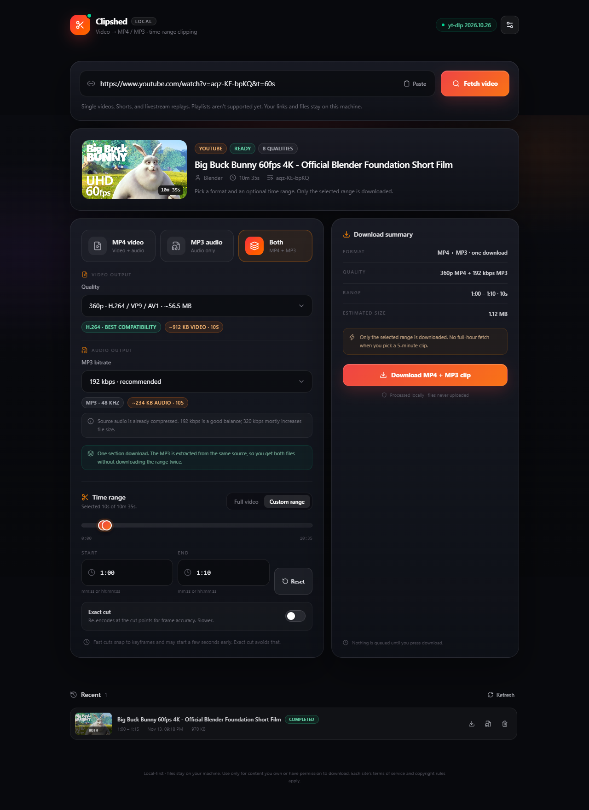

# Clipshed

**Download only the part you need.** Clipshed is a local-first video range clipper. Paste a YouTube, Facebook, or Instagram link, pick MP4, MP3, or both, and fetch just the section you want.

[](https://github.com/ivsharma/clipshed/actions/workflows/ci.yml)




## Why Clipshed?

Most downloaders fetch the entire video, then make you trim it afterward. Clipshed treats the time range as the primary input: **15:00–20:00** means it downloads only that section.

- **Range-first timeline** — drag handles or type exact times; chapter markers included.
- **MP4, MP3, or both** — “Both” downloads the section once and extracts the MP3 from it.
- **Fast or exact cut** — keyframe-aligned stream copy, or frame-accurate re-encode.
- **Local and private** — yt-dlp and ffmpeg run on your machine. No account, no cloud, no uploads.
- **Real job handling** — queue, live progress, cancellation, history, and cleanup.

## Supported platforms

| Platform | Status | What works |
|---|---|---|
| **YouTube** | Stable | Watch links, `youtu.be`, Shorts, embeds, livestream replays |
| **Facebook** | Experimental | `watch` links, reels, page videos, `fb.watch`; some posts need cookies |
| **Instagram** | Experimental | Posts, reels, IGTV; most content needs cookies from a signed-in browser |

Facebook and Instagram support depends on yt-dlp's extractors. See [Limitations](README_TECHNICAL.md#limitations) before relying on them.

## Quick start

Requirements: Windows 10/11 and Node.js **22+**.

```powershell
npm install
npm run setup
npm run dev
```

Open **http://127.0.0.1:5173**.

`npm run setup` downloads the standalone `yt-dlp.exe` and static `ffmpeg`/`ffprobe` builds into `bin/`. No Python install is required.

Production-style run:

```powershell
npm run build
npm start
```

Open **http://127.0.0.1:3000**. Or use `start.ps1`.

## How it works

Clipshed asks yt-dlp for only the selected section with `--download-sections`:

```text
yt-dlp --download-sections "*00:15:00.000-00:20:00.000" ...
```

- **MP4:** the selected video and audio ranges are downloaded and muxed.
- **MP3:** the audio range is downloaded and converted to MP3.
- **Both:** the MP4 section is downloaded once, then ffmpeg extracts the MP3 from it.
- **Fast cut** copies streams at keyframes; **Exact cut** re-encodes at the cut points for frame accuracy.

The app never downloads the full video just to trim it. For a 5-minute range, only that range is fetched.

## Configuration

Open the gear icon to configure cookies (for age-restricted or login-required posts), H.264 preference, and yt-dlp updates. Optional `.env` values include `PORT`, `HOST`, `MAX_CONCURRENT_JOBS`, and `JOB_TTL_HOURS`.

Cookies stay on this machine and are never returned by the API or written to job history.

## Documentation

The full reference is in [README_TECHNICAL.md](README_TECHNICAL.md):

- [Architecture](README_TECHNICAL.md#architecture)
- [Project layout](README_TECHNICAL.md#project-layout)
- [Comparison with other tools](README_TECHNICAL.md#comparison)
- [Adding a platform](README_TECHNICAL.md#adding-a-platform)
- [Command reference](README_TECHNICAL.md#commands)
- [Troubleshooting](README_TECHNICAL.md#troubleshooting)

## Limitations

- Single videos only; playlists and channels are rejected.
- Active live streams aren't supported; replays are.
- Facebook and Instagram are experimental and may need cookies.
- No subtitles, SponsorBlock, or compression presets yet.
- Windows-first setup; the server is local-only and binds to `127.0.0.1`.

## Disclaimer

Clipshed is a local, personal-use tool. Download only content you own or have permission to use, and follow each platform's terms and copyright rules. Don't use it to bypass DRM or access controls, and don't host it as a public service. Not affiliated with YouTube, Meta, or any other platform.

## License

MIT — see [LICENSE](LICENSE).
