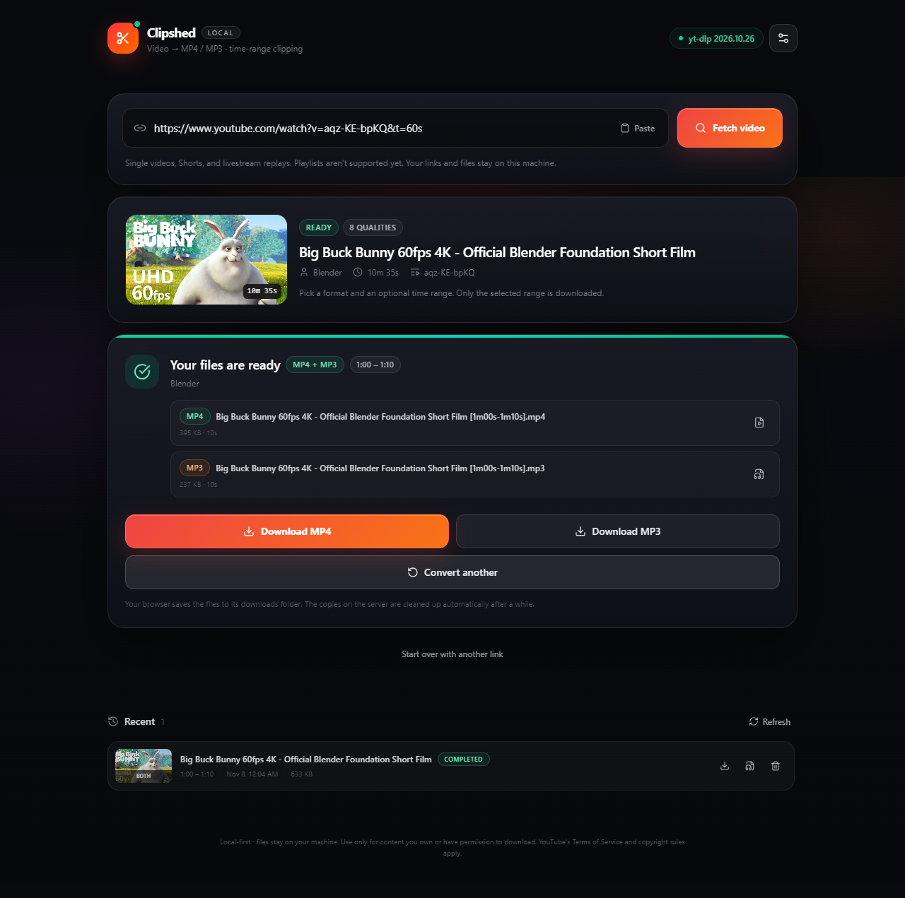
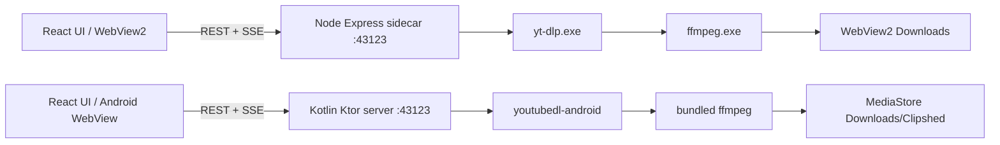

# Clipshed — Technical README

[← Back to the main README](../README.md)

This is the exhaustive reference: architecture, the Tauri Windows and Android shells, project layout, platform registry, command reference, and troubleshooting. For the quick overview, start with [README.md](../README.md).

**A local-first video range clipper.** Paste a link, pick MP4, MP3, or both, and fetch only the section you need — no full-hour download followed by a manual trim. Works with YouTube, Facebook, and Instagram links.

[](https://github.com/ivsharma/clipshed/actions/workflows/ci.yml)


## Why this exists

Most video downloaders treat the time range as an afterthought:

1. Download the entire video.
2. Open it in a separate editor.
3. Trim the part you actually wanted.

Clipshed treats the range as the primary input. If you want **15:00–20:00** from a one-hour talk, it downloads only that section, then merges or converts it locally.

It also exposes a workflow that generic yt-dlp GUIs usually hide: **fast vs exact cuts**, **MP4 + MP3 from one download**, live progress, cancellation, and a timeline with chapter markers.

## Screenshots


*Pick MP4, MP3, or both; drag the handles or type exact times.*



*One section download produces both MP4 and MP3, with separate download buttons.*

## Features

- **YouTube:** watch links, `youtu.be`, Shorts, embeds, and livestream replays
- **Facebook:** `watch` links, reels, page videos, and `fb.watch` links (experimental; some posts need a signed-in session, and cookie sign-in is coming soon)
- **Instagram:** posts, reels, and IGTV (experimental; most content needs a signed-in session, and cookie sign-in is coming soon)
- **MP4** with selectable resolution (H.264 up to 1080p by default; VP9/AV1 at higher resolutions)
- **MP3** at 128, 192, 256, or 320 kbps
- **Both** — MP4 and MP3 for the same range in one job
- **Full video** or an exact **start/end range**
- Timeline with draggable handles and chapter markers
- **Fast cut** (keyframe-aligned, no quality loss) or **Exact cut** (frame-accurate re-encode)
- Live progress over SSE: stage, percent, bytes, speed, ETA
- Cancellation that kills the whole yt-dlp/ffmpeg process tree
- Job history with re-download and cleanup
- Cookie-based access for age-restricted, private, or bot-checked videos is coming soon
- Light, Dark, and Dark contrast themes, remembered per device
- Check for updates against GitHub Releases
- Update yt-dlp from the settings dialog
- **Windows desktop app** — Tauri 2 + WebView2 shell with a bundled Node sidecar; yt-dlp, ffmpeg, and QuickJS are bundled, and no Node install is needed at runtime
- **Android app** — Tauri 2 shell with a Kotlin/Ktor server; downloads happen entirely on-device through `youtubedl-android`, and finished files are published to `Downloads/Clipshed`
- Local-only; no account, no cloud, no telemetry

## How the range download works

YouTube usually serves video and audio separately. Clipshed asks yt-dlp for only the selected section:

```text
yt-dlp --download-sections "*00:15:00.000-00:20:00.000" ...
```

- **MP4:** yt-dlp downloads the selected video and audio range and muxes them together.
- **MP3:** yt-dlp downloads the audio range and converts it to MP3.
- **Both:** the app downloads the MP4 section once, then extracts the MP3 from that same source. No second range download.

**Fast cut** uses stream copy. It is fast, lossless, and snaps the start to the nearest keyframe, so it may include a few extra seconds at the beginning. **Exact cut** adds `--force-keyframes-at-cuts`, which re-encodes at the cut points for frame accuracy; it is slower, especially at 4K.

MP3 is always re-encoded, so its cuts are effectively sample-accurate.

## Comparison

Stars are approximate as of November 2026 and change daily. This table is about **workflow**, not a scoreboard.

| Project | Stars | Form | Range-first? | Notes |
|---|---:|---|---|---|
| [Cobalt](https://github.com/imputnet/cobalt) | ~46k | Web/API, hosted or self-hosted | No | Beautiful multi-service downloader; full-item flow |
| [Seal](https://github.com/JunkFood02/Seal) | ~30k | Android app | No | Polished yt-dlp frontend for mobile |
| [MeTube](https://github.com/alexta69/metube) | ~15k | Self-hosted web UI (Docker) | Chapter split only | Great queue/playlists; not arbitrary start/end |
| [Open Video Downloader](https://github.com/jely2002/youtube-dl-gui) | ~10k | Desktop GUI (Tauri) | No | Cross-platform yt-dlp GUI |
| [yt-dlp-web-ui](https://github.com/marcopiovanello/yt-dlp-web-ui) | ~2.6k | Self-hosted web UI | No | Archived yt-dlp RPC/web UI |
| [yt-short-clipper](https://github.com/jipraks/yt-short-clipper) | ~1.1k | Desktop app | Automatic highlights | AI reframing/captions for Shorts; not manual ranges |
| [lord-of-the-clips](https://github.com/ranelpadon/lord-of-the-clips) | ~68 | CLI | Yes | Download, trim, merge; terminal-only |
| [RangeDownloader](https://github.com/A-Soul-Database/RangeDownloader) | ~21 | Python | Yes | Small, older range downloader |
| [Downcut](https://github.com/sagarjethi/self-hosted-video-downloader) | ~1 | Self-hosted web UI | Yes | Timeline cutter; Docker-oriented |
| **Clipshed** | — | **Local web app + Windows + Android** | **Yes** | **Timeline + MP4/MP3/Both + local-first** |

If you need playlists, channels, subtitles, or a Docker service, MeTube and Cobalt are stronger choices. Clipshed is intentionally narrower: one video, one range, clean local output.

## Quick start

Requirements: Windows 10/11 and Node.js **22+** to run from source. The packaged
desktop app does not need Node.js. Building the Android app additionally needs
JDK 21, the Android SDK, NDK 27.3, and the Rust Android targets; see
[Android build](#android-build).

```powershell
npm install
npm run setup
npm run dev
```

Open **http://127.0.0.1:5173**.

`npm run setup` downloads the standalone `yt-dlp.exe`, a static `ffmpeg` build, and QuickJS into `bin/`. No Python install is required.

### Production-style run

```powershell
npm run build
npm start
```

Open **http://127.0.0.1:3000**. Express serves the built React app and the API from the same origin.

Or:

```powershell
powershell -ExecutionPolicy Bypass -File start.ps1
```

### Windows desktop build (Tauri, primary)

The Windows app uses Tauri 2 for the native window and WebView2 for rendering.
The existing Express server still does the download work, but it now runs as a
bundled **Node sidecar** instead of inside a Chromium-based wrapper. This keeps the mature
yt-dlp/ffmpeg logic while removing Chromium from the package.

```powershell
npm install
npm run setup
npm run tauri:windows:build
```

Output:

```text
src-tauri\target\release\bundle\nsis\Clipshed_1.1.0_x64-setup.exe
```

For development:

```powershell
npm run tauri:windows:dev
```

The dev script uses `tauri dev --no-watch --no-dev-server-wait`. Tauri normally
starts the frontend dev server itself; Clipshed starts its own Node server on
port `43123`, so those Tauri behaviors must be disabled.

The Tauri Windows build additionally needs the Rust MSVC toolchain and WebView2;
WebView2 ships with Windows 11 and current Windows 10/Edge installs. The app uses
`%LOCALAPPDATA%\Clipshed` for data and the managed yt-dlp copy, the same location
as earlier builds. The full startup, window, plugin, download, and sidecar details are
in [Tauri Windows shell](#tauri-windows-shell-rust).

### Android build

The Android app uses the same React UI, a Kotlin/Ktor server, and
`youtubedl-android` for the download engine. Downloads run on-device and are
saved through MediaStore to `Downloads/Clipshed`.

Prerequisites: JDK 21, Android SDK, NDK 27.3, and the Rust Android targets.
Then:

```powershell
powershell -ExecutionPolicy Bypass -File scripts/build-android.ps1 -Target aarch64 -Release
```

Output:

```text
src-tauri\gen\android\app\build\outputs\apk\arm64\release\app-arm64-release.apk
```

The wrapper works around Windows symlink restrictions; see
[Building the Android APK on Windows](#building-the-android-apk-on-windows).
Release APKs use a real keystore only when
`src-tauri/gen/android/keystore.properties` exists; otherwise they fall back to
the debug key with a warning. See [Signing](#signing).

The full Android runtime model is in
[Tauri Android shell](#tauri-android-shell-kotlin-and-ktor).

## Architecture

Clipshed now has one frontend and three shells. The frontend always talks to a
loopback HTTP API; it never talks to a site directly.



| Runtime | Shell | API server | Download engine | Output |
|---|---|---|---|---|
| Windows (primary) | Tauri 2 + WebView2 | Node 22+ sidecar (current build Node 26), fixed `127.0.0.1:43123` | bundled `yt-dlp.exe` + `ffmpeg.exe` | WebView2 download to the user's Downloads folder |
| Android | Tauri 2 + system WebView | Kotlin/Ktor, fixed `127.0.0.1:43123` | `youtubedl-android` (Python, yt-dlp, ffmpeg, QuickJS) | MediaStore `Downloads/Clipshed` |

- **Why Tauri:** a Chromium-based desktop shell would bundle a complete browser
  runtime (~309 MB). Tauri uses the system WebView (WebView2 on Windows, Android
  WebView on mobile), which cuts the shell size and is the only practical way to
  reuse this UI on Android. Tauri is a shell, not a download engine: yt-dlp and
  ffmpeg still do the work.
- **Why Windows keeps Node:** the Express server, job manager, progress parsers,
  and yt-dlp error rules are mature and covered by tests. Running them as a
  sidecar reuses that code unchanged. Porting them to Rust is the optional
  Phase 3 project described in [TAURI_MIGRATION.md](TAURI_MIGRATION.md).
- **Why Android gets Kotlin:** mobile Node runtimes do not support
  `child_process`, which the Node server needs to spawn yt-dlp and ffmpeg.
  Android therefore has a second API implementation in Kotlin, using
  `youtubedl-android` for the engine. This is the main maintenance tradeoff of
  the migration: two servers must keep the same contract.
- **Shared contract:** `shared/src` defines the API types, Zod schemas, and
  platform URL rules. Kotlin mirrors the same JSON shapes in `Models.kt` and
  `Platforms.kt`. The UI uses relative `/api` paths everywhere, so it does not
  care which server it is talking to.
- **Fixed port:** Tauri's window URL is static, so both shells use
  `127.0.0.1:43123`. The Windows shell prevents a second app instance from
  competing for that port.
- **Jobs:** the Node and Kotlin servers both keep a small queue (one concurrent
  download by default), persist history as JSON, stream updates over SSE, and
  clean up finished files after a TTL.
- **Platforms:** the server only accepts URLs from the registered platform
  parsers and passes yt-dlp a canonical URL, never arbitrary user input.
- **Cookies:** cookie sign-in is intentionally disabled in the UI, the Node
  config, and the Kotlin `SettingsStore`. Existing cookie settings are ignored
  until the feature returns.
- **Security boundary:** both servers bind `127.0.0.1` and have no
  authentication, matching the original local-only design. Tauri currently sets
  `csp: null`; the UI relies on an inline theme script, so tightening CSP would
  need an allowance for that script. The Windows shell compensates with a strict
  navigation guard. The Android bridge exposes only
  insets, system-bar theme, and validated external links to the local page. Do
  not expose either server on a shared or untrusted network.

### Tech stack

| Layer | Choice |
|---|---|
| UI | React 19, Vite 8, TypeScript, Tailwind CSS 4 |
| Windows desktop shell | Tauri 2.12, Rust 1.90, WebView2, NSIS |
| Windows API | Node 22+ sidecar (current build Node 26), Express 5, Zod |
| Android shell | Tauri 2 Android, Kotlin 2.2, AndroidX WebKit |
| Android API | Ktor 3.2 CIO, kotlinx.serialization |
| Android engine | `youtubedl-android` 0.18.1 (Python, yt-dlp, ffmpeg, QuickJS) |
| Download engine | yt-dlp (bundled standalone on desktop) |
| Media | ffmpeg (desktop binaries; `youtubedl-android` ffmpeg on Android) |
| Server bundle | esbuild (`server.cjs`) |
| yt-dlp JS runtime | QuickJS-ng on packaged desktop; bundled QuickJS on Android; Node in development |
| Progress | Server-Sent Events |
| Storage | Local JSON history + app data folders |
| Tests | Vitest (TypeScript); Rust/Kotlin have no unit tests yet |

## Tauri migration: what changed and why

The migration kept the React UI and the HTTP/SSE contract. It replaced the
previous Chromium-based Windows shell and added an Android app. The
phase-by-phase history, measured sizes, and remaining migration checklist are in
[TAURI_MIGRATION.md](TAURI_MIGRATION.md). The important mental model is:

```text
Windows: React UI -> http://127.0.0.1:43123 -> Node sidecar -> yt-dlp.exe / ffmpeg.exe
Android: React UI -> http://127.0.0.1:43123 -> Kotlin/Ktor -> youtubedl-android
```

### Shared UI contract

The frontend still uses relative URLs (`/api/...`) and `EventSource`. It has no
Tauri IPC dependency for its normal workflow. That is what makes it usable in a
browser and both Tauri shells without a second UI.

`shared/src` remains the source of truth for the JSON shapes, validation, URL
platforms, and formatting. The Kotlin server mirrors those shapes rather than
inventing its own API. When changing a request or response field, check all of:

- `shared/src/types.ts` and `shared/src/schemas.ts`
- the Node routes and services in `server/src`
- the Kotlin models and routes in `src-tauri/gen/android/.../server`
- the UI in `web/src`

### Request lifecycle (follow one click)

This is the shortest path through the code when you are tracing a bug:

1. **Probe:** `UrlForm` calls `api.probe()` → `POST /api/probe` → the platform
   parser canonicalizes the URL → the server calls yt-dlp with
   `--dump-single-json` → `ProbeResult` is normalized and returned → the UI shows
   `VideoCard`, qualities, duration, and chapters.
2. **Create job:** `App.handleStart()` calls `POST /api/jobs` → the server
   validates the range and quality → adds the job to the queue → returns a
   `Job` immediately.
3. **Run job:** the single worker sets `resolving` → probes again (cached) →
   `running` → `Downloader`/`download.ts` invokes yt-dlp and ffmpeg → progress
   events are written to SSE.
4. **Finish:** `JobManager`/`job-manager.ts` stores the output metadata and emits
   a terminal event. `JobPanel` switches from progress to the delivery view.
5. **Save on desktop:** the delivery view follows `downloadUrl`
   (`/api/jobs/{id}/file?kind=...`). The server serves the file with an
   attachment header; WebView2 hands it to the Downloads folder.
6. **Save on Android:** the delivery view calls
   `POST /api/jobs/{id}/save`; `JobManager.saveOutput()` calls
   `MediaStoreSaver`, copying the app-private file into `Downloads/Clipshed`.
7. **History:** both servers read/write `jobs.json`; `GET /api/jobs` returns the
   recent list for `HistoryList`.

The Node path is `server/src/routes.ts` → `job-manager.ts` → `media/download.ts`.
The Android path is `Server.kt` → `JobManager.kt` → `Downloader.kt`. They share
the same JSON contract, not the same code.

### Platform split and why

| Concern | Windows Tauri | Android Tauri |
|---|---|---|
| Native shell | Rust in `src-tauri/src/lib.rs` | Rust plus Kotlin in `src-tauri/gen/android` |
| API | Existing Node/Express, bundled as a sidecar | New Kotlin/Ktor server |
| Engine | Standalone `yt-dlp.exe` + `ffmpeg.exe` | `youtubedl-android` Python/yt-dlp/ffmpeg |
| JS runtime | Bundled QuickJS-ng sidecar resource | QuickJS bundled by `youtubedl-android` |
| Port | Fixed `43123` | Fixed `43123` |
| User-visible output | WebView2 Downloads folder | MediaStore `Downloads/Clipshed` |
| Process model | Tauri process + `node.exe` child | Tauri process + in-process Ktor coroutines |

**Why not one server everywhere?** Android cannot run the Node server as-is:
mobile Node runtimes do not support `child_process`, and the Node downloader
depends on spawning yt-dlp and ffmpeg. `youtubedl-android` is a native library
that runs Python and ffmpeg inside the app instead. That makes the Kotlin server
the natural Android boundary.

**Why keep Node on Windows?** It already has the queue, progress parsers,
filename rules, cleanup, update checks, and yt-dlp error mapping. Replacing it
with Rust would save about 95 MB, but it is a rewrite with no user-facing feature
gain. It remains an optional Phase 3 project.

### Tauri Windows shell (Rust)

#### Files

| File | Responsibility |
|---|---|
| `src-tauri/src/main.rs` | Tiny entrypoint; calls `app_lib::run()`, hides the console in release |
| `src-tauri/src/lib.rs` | All Windows lifecycle: plugins, sidecar, window, downloads, links, shutdown |
| `src-tauri/tauri.conf.json` | Shared product metadata, window base config, Android debug suffix |
| `src-tauri/tauri.windows.conf.json` | Windows overlay: 1180×760 window, `create:false`, resources (including notices), `externalBin` |
| `src-tauri/Cargo.toml` | Tauri 2 and Windows-only plugins |
| `src-tauri/capabilities/default.json` | Desktop capability; only `core:default` |
| `desktop/sidecar.cjs` | Starts the compiled Express server and handles SIGINT/SIGTERM |
| `scripts/stage-tauri-windows.mjs` | Copies the current `node.exe` to `src-tauri/binaries/node-<triple>.exe` |
| `scripts/build-desktop.mjs` | Bundles `server/src/server.ts` to `desktop/build/server.cjs` |
| `src-tauri/icons/` | Windows installer/icons generated from the shared source icon |

The generated Android files under `src-tauri/gen/android` are tracked because
they contain the app's Kotlin server and manifest changes. Do not edit the
generated `TauriActivity.kt`, `WryActivity.kt`, `RustWebViewClient.kt`, or
`RustWebView.kt`; they are Tauri/Wry plumbing and can be regenerated.

#### Startup sequence

1. `main.rs` calls `app_lib::run()`.
2. `run()` builds a Tauri app and registers plugins. `single-instance` must be
   first so a second launch is rejected before any setup work.
3. In `setup`, `start_sidecar()` resolves the packaged resources and starts
   `node.exe` with `shell().sidecar("node")`.
4. The sidecar receives the app-home/data/bin paths, ffmpeg directory, QuickJS
   path, web build directory, app version, host, and port.
5. The Rust side polls TCP `127.0.0.1:43123` for up to 20 seconds. This avoids
   showing a blank window before Express is listening.
6. Once the port is open, Rust reads the window config and creates the
   WebView2 window with the download, permission, navigation, and new-window
   handlers.
7. The window is shown. The sidecar's stdout/stderr are forwarded to Rust's log
   stream; the log plugin is enabled in debug builds.
8. On `RunEvent::Exit`, Rust kills the sidecar.

The fixed port is a deliberate tradeoff. Tauri's configured window URL is
static, and Android uses the same URL. A second Windows launch is prevented by
the single-instance plugin. An unrelated process already listening on `43123`
will cause the 20-second startup timeout; use the troubleshooting table below.

#### Plugins and why they exist

| Plugin | Use |
|---|---|
| `tauri-plugin-shell` | Spawn and manage `node.exe` as a sidecar |
| `tauri-plugin-single-instance` | Exit the second launch, restore/focus the existing window |
| `tauri-plugin-notification` | Windows toast when a download finishes |
| `tauri-plugin-opener` | Open external links in the default browser |
| `tauri-plugin-log` | Debug-build logging only |

The plugins are invoked from Rust, not JavaScript, so the capability file only
needs `core:default`. If you later call a Tauri plugin from the webview, add the
matching permission to `src-tauri/capabilities/default.json`.

#### Window creation and handlers

`WebviewWindowBuilder::from_config` is used because the Windows overlay sets
`create:false` and `visible:false`. Tauri therefore does not create a window at
startup; Rust creates it only after the sidecar is ready, then shows it.

The builder installs four behaviors:

- **Permission requests:** allow `AutomaticDownloads` and `ClipboardRead`.
  WebView2 otherwise blocks the second download with an “Automatic downloads”
  prompt and may deny clipboard reads used by the Paste button.
- **Downloads:** on `Requested`, replace the destination with a unique path
  (`name (1).mp4`). On `Finished`, show a notification titled `Clipshed` with
  `<filename> saved to Downloads`.
- **Navigation:** only `http://127.0.0.1:43123` is allowed inside the webview.
  Other `http(s)` URLs are opened externally and the navigation is cancelled.
- **New windows:** `on_new_window` denies the popup and opens `http(s)` URLs in
  the default browser. This covers links such as “Open release” in Settings.

File-link clicks (`/api/jobs/<id>/file`) are local navigations/downloads and are
left to WebView2. This is why the download handler can intercept them.

#### Data, environment, and managed binaries

| Path | Purpose |
|---|---|
| `%LOCALAPPDATA%\Clipshed\data\jobs.json` | Job history |
| `%LOCALAPPDATA%\Clipshed\data\downloads` | Temporary server copies |
| `%LOCALAPPDATA%\Clipshed\data\tmp` | In-progress files |
| `%LOCALAPPDATA%\Clipshed\bin\yt-dlp.exe` | Managed, updatable copy |
| `resources\bin\ffmpeg.exe` | Bundled ffmpeg |
| `resources\bin\qjs.exe` | Bundled QuickJS |
| `resources\web\` | Built React UI |
| `resources\server\server.cjs` | Compiled Node server |
| `resources\server\sidecar.cjs` | Sidecar bootstrap |
| `resources\LICENSE` | Clipshed MIT license |
| `resources\THIRD_PARTY_NOTICES.md` | Third-party notices |

The managed yt-dlp copy is “missing only”: an existing copy is never
overwritten, so an in-app update survives restarts and reinstalls. Old
ffmpeg/ffprobe/qjs copies in the app home are deleted at startup because older
builds staged them there; the current build only needs yt-dlp there.

The sidecar environment maps to those paths:

| Variable | Release value |
|---|---|
| `CLIPSHED_ROOT` | `%LOCALAPPDATA%\Clipshed` |
| `DATA_DIR` | `%LOCALAPPDATA%\Clipshed\data` |
| `BIN_DIR` | `%LOCALAPPDATA%\Clipshed\bin` |
| `FFMPEG_DIR` | `resources\bin` |
| `QJS_PATH` | `resources\bin\qjs.exe` |
| `WEB_DIST` | `resources\web` |
| `CLIPSHED_VERSION` | Tauri package version |
| `HOST` / `PORT` | `127.0.0.1` / `43123` |
| `NODE_ENV` | `production` |

In a debug build, `lib.rs` resolves the project root instead: the server script
is `desktop/sidecar.cjs`, the web root is `web/dist`, and the media binaries come
from the repository `bin` directory.

#### Build pipeline

```text
npm run build -w web            -> web/dist
npm run desktop:server          -> desktop/build/server.cjs
npm run tauri:stage             -> src-tauri/binaries/node-<triple>.exe
tauri build                     -> Rust + WebView2 + NSIS installer
```

`tauri.windows.conf.json` maps those files into the installer. The Node sidecar
is copied as `node.exe`; the web build, server bundle, and media binaries are
resources. `tauri:windows:dev` runs the same preparation but launches the app
from the Rust dev profile.

### Tauri Android shell (Kotlin and Ktor)

Unlike Windows, there is very little custom Rust on Android. Tauri's Rust entry
point starts the mobile runtime, while `ClipshedApplication`, `MainActivity`, and
the Kotlin server do the actual app work. Everything runs in the app process; the
only external process-like boundary is `youtubedl-android`'s Python/ffmpeg
execution.

#### Files

Kotlin paths below are relative to
`src-tauri/gen/android/app/src/main/java/com/clipshed/app`.

| File | Responsibility |
|---|---|
| `ClipshedApplication.kt` | Starts the server in `Application.onCreate` |
| `MainActivity.kt` | Tauri activity, notification permission, safe-area/theme/link bridge |
| `server/Server.kt` | `ServerHost`, Ktor setup, routes, asset copy, health |
| `server/Models.kt` | `@Serializable` API/job/settings mirrors |
| `server/Platforms.kt` | URL parsing, time parsing, filename/range helpers |
| `server/ProbeService.kt` | yt-dlp metadata probe, cache, timeout, quality building |
| `server/Downloader.kt` | yt-dlp download, progress parsing, MP3 extraction, duration |
| `server/JobManager.kt` | Queue, lifecycle, SSE, cancellation, persistence, cleanup |
| `server/DownloadService.kt` | Foreground service and progress notification |
| `server/MediaStoreSaver.kt` | Copies finished files to `Downloads/Clipshed` |
| `server/SettingsStore.kt` | Settings JSON and cookie-file handling |
| `server/Updates.kt` | GitHub release check |
| `server/ErrorMapper.kt` | yt-dlp stderr to stable API error codes |

#### Startup sequence

1. Android creates `ClipshedApplication`.
2. `ServerHost.start()` copies the web build from APK assets into
   `filesDir/web` (assets are read-only/compressed, while Ktor's static file
   handler needs a normal directory), initializes the
   settings/probe/downloader/job/update services, starts the job worker, and
   starts Ktor CIO on `127.0.0.1:43123`.
3. In the background it initializes `YoutubeDL` and `FFmpeg`. If yt-dlp has no
   version yet, it tries an automatic update.
4. `MainActivity` extends Tauri's activity and loads the fixed local URL.
5. `ServerHost.ready` gates probe/job requests until the engine initialization
   finishes, so the UI can load before Python/yt-dlp is ready.

The server lives in the Application, not the Activity, so activity recreation
(rotation, process foregrounding) does not restart the HTTP server or lose the
job queue.

#### Android API

The route surface mirrors Node:

- `GET /api/health`
- `POST /api/probe`
- `GET/PUT /api/settings`
- `GET/POST /api/jobs`
- `GET /api/jobs/{id}`
- `GET /api/jobs/{id}/events` (SSE with a 15-second heartbeat)
- `POST /api/jobs/{id}/cancel`
- `GET /api/jobs/{id}/file`
- `DELETE /api/jobs/{id}`
- `POST /api/ytdlp/update`
- `GET /api/updates/check`

Android adds three routes that the Node server does not have:

- `GET /api/clipboard` — reads the Android clipboard on the main thread.
- `POST /api/jobs/{id}/save` — copies a finished file through MediaStore.
- `POST /api/settings/cookies` — backend import retained while the UI is
  disabled.

`Health.nodeVersion` is reused on Android for the OS label (`Android 15`). This
keeps the shared TypeScript `Health` shape unchanged; it is not a Node version on
mobile and should not be renamed without changing both servers and the UI.

#### Jobs and persistence

- `JobManager` owns a `Channel<String>` queue and a single worker coroutine.
- Statuses are `queued`, `resolving`, `running`, `completed`, `failed`, and
  `cancelled`; active jobs are tracked in a concurrent map.
- Each state change creates a snapshot and emits a `JobEvent` through a
  `MutableSharedFlow`. SSE collectors filter by job ID; a late subscriber gets a
  `snapshot` first.
- Cancellation marks the job, updates the UI, and destroys the yt-dlp process
  plus any ffmpeg process held by the download handle.
- History is `filesDir/jobs.json`, capped at 100 entries. Writes go to a temp
  file and rename atomically. Jobs that were active when the process died are
  marked failed with an `INTERRUPTED` error on the next load.
- Cleanup runs at startup and hourly. A job’s app-private temp files are removed
  on cancel; completed downloads are removed after 24 hours.

#### Download pipeline

`Downloader.download()` is the Android equivalent of the Node media path:

1. Create `filesDir/tmp/<jobId>` and `filesDir/downloads/<jobId>`.
2. Build a `YoutubeDLRequest` with `--newline`, retries, fragment retries,
   concurrent fragments, metadata embedding, and the canonical URL.
3. Select audio-only for MP3, or a video+audio format selector for MP4. The
   selector prefers H.264 when the user enables that setting.
4. Add `--download-sections` for a range and
   `--force-keyframes-at-cuts` for exact MP4 cuts.
5. Parse yt-dlp progress lines and ffmpeg `out_time_us` lines into the same
   `JobProgress` shape used by the UI. Updates are throttled to 250 ms.
6. For `both`, download the MP4 once, then invoke the bundled native ffmpeg
   directly to extract the MP3. This avoids a second network download and is the
   reason `Downloader.kt` contains its own ffmpeg invocation.
7. Read duration from ffmpeg's input banner (there is no ffprobe on Android).
8. Move final files into the job’s app-private downloads folder and delete the
   temp directory.

The background service is separate from the job worker. `JobManager` calls
`DownloadService.start()` when a job is queued, updates it at most once per
second, and stops it when no jobs remain. The service uses a low-importance
“Downloads” channel and an ongoing progress notification. Android 13+ requires
the `POST_NOTIFICATIONS` runtime permission, requested in `MainActivity`.

The manifest declares `INTERNET`, `FOREGROUND_SERVICE`,
`FOREGROUND_SERVICE_DATA_SYNC`, and `POST_NOTIFICATIONS`; the service is declared
with `foregroundServiceType="dataSync"`. Cleartext traffic is enabled only because
the app talks to its own `127.0.0.1` server.

#### Saving to the user's Downloads folder

Android uses scoped storage. The server writes to app-private
`filesDir/downloads`, then `MediaStoreSaver` copies the file into the shared
`Downloads/Clipshed` collection using `MediaStore.Downloads` with
`IS_PENDING=1` until the copy completes. This avoids asking for broad storage
permissions and works on modern Android.

The UI does not navigate to the file URL on Android. `JobPanel.tsx` detects
Android and calls `POST /api/jobs/{id}/save`, showing a
“Saved ... to Downloads/Clipshed” note. On desktop it keeps the normal file link.

#### Settings, cookies, and updates

- `preferH264` is the only active download preference.
- `cookiesEnabled = false` in `SettingsStore.kt`; cookie arguments are never
  passed to yt-dlp. The import endpoint and file storage remain for a future
  release. Browser-cookie mode cannot work on Android.
- yt-dlp updates on first launch when no version is present, and from Settings
  via `POST /api/ytdlp/update`.
- The app version comes from `PackageManager`; update checks call the same
  GitHub releases API as Node and cache for 10 minutes.
- `ErrorMapper.kt` mirrors the Node error-code table, including bot checks,
  age/member/private restrictions, geo-blocks, DRM, format errors, 403/429,
  ffmpeg, disk, and network failures.

#### Android WebView integration

`MainActivity` is the bridge between Tauri's generated WebView and the shared
UI. It does four things:

1. **Edge-to-edge insets.** The app targets SDK 36, so Android draws it behind
   the status and navigation bars. `MainActivity` listens for
   `systemBars() | displayCutout()` insets on the WebView, converts physical
   pixels to density-independent pixels, and exposes them through a JavaScript
   interface named `ClipshedShell`.
2. **Document-start injection.** `WebViewCompat.addDocumentStartJavaScript`
   installs `window.__clipshedApplySafeAreaInsets`, which writes
   `--safe-area-inset-*` CSS variables on `<html>`. The inset listener calls it
   after load and on every inset change.
3. **Theme-aware system bars.** The inline theme script in `index.html` and
   `applyTheme()` call `ClipshedShell.setDarkTheme(...)`, which sets
   `isAppearanceLightStatusBars` and `isAppearanceLightNavigationBars`. This is
   needed because the app theme is independent of the system dark-mode setting.
4. **External links.** The web UI's global click handler detects cross-origin
   `http(s)` anchors and calls `ClipshedShell.openExternal`. The Kotlin side
   validates the scheme/host and starts `ACTION_VIEW` with a browser category.
   This exists because Android WebViews ignore `target="_blank"` links when no
   popup handler is installed.

The JavaScript interface is deliberately small and Android-only. It avoids
adding another Tauri plugin or replacing Wry's generated `WebViewClient`, which
also handles request interception, range responses, and Tauri IPC.

#### Web CSS for safe areas

The web side uses the bridge values as CSS variables:

- `web/index.html` sets `viewport-fit=cover`.
- `index.css` defines the four `--safe-area-inset-*` variables with `env()` as a
  fallback, then pads `body`.
- Fixed `body::before` / `body::after` masks cover the status and navigation bar
  areas while the document scrolls. Body padding alone would scroll away and
  let content reappear under the icons.
- The settings sheet uses `.settings-overlay` padding because it is
  `position: fixed` and does not inherit body padding.
- The toast uses `.toast-safe` for the same reason.

On desktop all four variables resolve to `0px`, so these rules are inert.

#### Android data paths

| Path | Purpose |
|---|---|
| `filesDir/web` | Extracted web build served by Ktor |
| `filesDir/jobs.json` | Job history |
| `filesDir/settings.json` | Settings |
| `filesDir/downloads/<jobId>` | Files served by `/api/jobs/{id}/file` |
| `filesDir/tmp/<jobId>` | In-progress download/merge files |
| `Downloads/Clipshed` | User-visible MediaStore copies |

App-private files are removed when the app is uninstalled. MediaStore copies in
`Downloads/Clipshed` are owned by the user and remain.

#### Building the Android APK on Windows

The app is built with `compileSdk = 36`, `targetSdk = 36`, and `minSdk = 29`.
The Gradle `copyWebAssets` task copies `web/dist` into the APK assets on every
preBuild. The Rust `.so` is built once per ABI; `scripts/build-android.ps1`
copies it into `jniLibs` and runs Gradle with the Rust tasks skipped to avoid a
Windows symlink failure. The arm64 release build also sets 16 KB page-size linker
flags.

#### External-link and clipboard behavior in the shared UI

- `web/src/lib/externalLinks.ts` installs one document-level click listener. It
  only intercepts cross-origin `http(s)` links and only when the Android shell
  bridge is present. Desktop and browser builds keep normal anchor behavior.
- `UrlForm.tsx` tries the Android clipboard endpoint first, then the browser
  Clipboard API. Android WebViews commonly deny the async clipboard API when the
  page is not focused; the local server can read the clipboard on the main
  thread.
- Android detection uses the user-agent string. This is intentionally simple and
  assumes the Tauri app, not an Android browser pointed at a development server.

### Reading guide

| If you want to understand... | Start here |
|---|---|
| Windows app startup, plugins, sidecar, window | `src-tauri/src/lib.rs` |
| Windows server process | `desktop/sidecar.cjs`, `desktop/build/server.cjs` |
| Windows resources and NSIS | `src-tauri/tauri.windows.conf.json`, `scripts/stage-tauri-windows.mjs` |
| Android app startup | `ClipshedApplication.kt`, `MainActivity.kt` |
| Android HTTP API | `server/Server.kt` |
| Android job lifecycle | `server/JobManager.kt` |
| Android download/media work | `server/Downloader.kt`, `server/ProbeService.kt` |
| Android notifications/service | `server/DownloadService.kt` |
| Android saving to Downloads | `server/MediaStoreSaver.kt`, `JobPanel.tsx` |
| Android safe area/theme/links | `MainActivity.kt`, `web/src/index.css`, `web/src/lib/theme.ts`, `web/src/lib/externalLinks.ts` |
| Node API | `server/src/routes.ts`, `server/src/app.ts` |
| Shared contract | `shared/src/types.ts`, `shared/src/schemas.ts`, `shared/src/platforms.ts` |

#### Debugging the shells

- **Windows:** use `npm run tauri:windows:dev` to see Rust and sidecar output.
  The release build is a windowed executable with no console. Check
  `http://127.0.0.1:43123/api/health` while the app is running.
- **Android:** use the debug package (`com.clipshed.app.debug`) and
  `adb logcat` for Kotlin/yt-dlp output. A debug WebView exposes a devtools
  socket; find it with `adb shell cat /proc/net/unix | findstr devtools`, then
  `adb forward tcp:9223 localabstract:webview_devtools_remote_<pid>` and open
  `http://127.0.0.1:9223/json/list` for CDP inspection.
- **Server API:** the same `/api/health` response works on both backends and is
  the quickest check for a sidecar or engine failure.

### Change log from the pre-migration build

| Change | Why | Where it lives |
|---|---|---|
| Chromium-based Windows shell replaced by Tauri + WebView2 | Remove the bundled browser runtime and gain a mobile shell | `src-tauri/src/lib.rs`, `desktop/sidecar.cjs` |
| Node server bundled as a sidecar on Windows | Reuse the tested Express/job/download code instead of rewriting it | `src-tauri/tauri.windows.conf.json`, `scripts/stage-tauri-windows.mjs` |
| Android app added with Kotlin/Ktor and `youtubedl-android` | Mobile Node cannot spawn yt-dlp/ffmpeg; downloads must run on-device | `src-tauri/gen/android/.../server`, `web` |
| Fixed local port `43123` for both Tauri shells | Tauri window URLs are static; one contract for Windows and Android | `lib.rs`, `ServerHost.kt` |
| WebView2 download handler and completion toast | Match the previous desktop download flow without a custom session API | `on_download` in `lib.rs` |
| Single-instance focus and navigation guard | Prevent a second server on the same port and keep the webview local | `lib.rs` plugins/handlers |
| Android foreground download service | Android may suspend the app while a download is running | `DownloadService.kt` |
| MediaStore save endpoint and Android-specific UI path | Scoped storage and a user-visible `Downloads/Clipshed` output | `MediaStoreSaver.kt`, `JobPanel.tsx` |
| Android clipboard endpoint | Android WebViews deny the async clipboard API | `Server.kt`, `UrlForm.tsx` |
| Safe-area bridge and fixed CSS masks | Target SDK 36 enforces edge-to-edge; content must stay clear of system bars | `MainActivity.kt`, `index.css` |
| Theme-aware system bar icons | The app theme is independent of Android's system theme | `MainActivity.kt`, `theme.ts` |
| External-link bridge | Android WebViews swallow `target="_blank"` links | `externalLinks.ts`, `MainActivity.kt` |
| `ffprobe` removed | Duration is available from ffmpeg's input banner; trims ~162 MB from the packaged app | `server/src/media`, `Downloader.kt` |
| Cookie sign-in disabled | Temporary product decision; backend code is retained | `config.ts`, `SettingsStore.kt`, `SettingsDialog.tsx` |
| Release keystore plumbing | Keep signing material out of git while making release builds reproducible | `build.gradle.kts`, `keystore.properties.example` |

### Verification status and known gaps

Verified on this machine / the Android 15 x86_64 emulator:

- Windows: installed NSIS app launches, health is green, MP4 job completes,
  duplicate downloads get `(1)`/`(2)` names, completion toast appears, second
  launch focuses the existing window, external links open in the browser, and the
  app/sidecar shut down together.
- Android: real UI loads, probe/download/MP4/MP3/Both/background/cancel work,
  MediaStore save works, clipboard Paste works, yt-dlp updates, safe areas and
  theme-aware system bars work, settings sheet fits, and external links open
  Chrome.
- TypeScript typecheck and 96 Vitest tests pass.

Not yet verified or still missing:

- Physical arm64 phone test and a clean Windows machine/VM install pass.
- Code signing for either platform; see [Signing](#signing).
- Automatic app updates; update checks only link to GitHub releases.
- Cross-backend contract tests. The Kotlin server is a second implementation and
  can drift from Node; add contract tests when changing the API.
- The Android build prints harmless Rust warnings about Windows-only imports
  when compiled for Android.
- Phase 3 (Rust server on Windows) is optional and not planned for this release.

## Signing

Neither shipped artifact is suitable for public distribution until it is signed.

### Android release keystore

Copy `src-tauri/gen/android/keystore.properties.example` to
`src-tauri/gen/android/keystore.properties` and point `storeFile` at a release
keystore. The path is resolved relative to `src-tauri/gen/android`; both the
properties file and `*.jks`/`*.keystore` files are gitignored. If the properties
file is absent, release builds warn and fall back to the Android debug key.

```powershell
keytool -genkeypair -v -keystore clipshed-release.jks -alias clipshed `
  -keyalg RSA -keysize 4096 -validity 10000
```

Back up the keystore and passwords. Updates must be signed with the same key.
The debug APK (`applicationId` ends in `.debug`) and release APK (`com.clipshed.app`)
can coexist on a test device, but you cannot install a release APK over one
signed with a different key.

### Windows Authenticode

A self-signed certificate does not remove SmartScreen warnings. Use a CA-issued
OV/EV Authenticode certificate or Azure Trusted Signing. Put the certificate in
the Windows certificate store and reference its thumbprint from the Tauri
Windows bundle config:

```json
{
  "bundle": {
    "windows": {
      "certificateThumbprint": "<thumbprint>",
      "digestAlgorithm": "sha256",
      "timestampUrl": "http://timestamp.digicert.com"
    }
  }
}
```

This thumbprint is not present in the repository yet; add it only after the
certificate is installed. Then rebuild and verify both `app.exe` and the NSIS
installer with `signtool verify /pa /v`.

## Package size

**Windows Tauri build (primary):** about **295.5 MB** installed, with a
**97.8 MiB** NSIS installer (measured November 19, 2026).

| Part | Approx. size |
|---|---:|
| Tauri shell (`app.exe`) | 12.0 MB |
| Bundled `node.exe` sidecar | 95.5 MB |
| `ffmpeg.exe` | 162.2 MB |
| `yt-dlp.exe` | 22.5 MB |
| QuickJS | 2.1 MB |
| Server bundle, web UI, notices | 2.4 MB |

Tauri uses the shared WebView2 runtime instead of bundling Chromium. WebView2 is
not included in this number; it ships with Windows 11 and current Windows 10/Edge
installs. A fixed-runtime bundle would add roughly 180 MB.

After first launch, `%LOCALAPPDATA%\Clipshed` adds only the managed yt-dlp copy
(~23 MB) plus history and downloads, not a second copy of ffmpeg or QuickJS.

**Android build:** **71.3 MB** for the current arm64 release APK (debug-signed
until a release keystore is configured). The APK contains the Python runtime,
yt-dlp, ffmpeg, and QuickJS, but not a browser; it uses the system Android
WebView. Debug APKs are larger (about 146.7 MB for x86_64) because they keep
debug symbols and native debug metadata for that ABI. The exact size varies by
ABI and build type; the files are under
`src-tauri/gen/android/app/build/outputs/apk/`.

Possible reductions for the Windows build, roughly in order of effort versus
payoff:

| Option | Approx. installed saving | Approx. artifact saving | Tradeoff |
|---|---:|---:|---|
| Port the Node server to Rust and remove the sidecar | ~95 MB | ~30–40 MB | Largest effort; keeps the same HTTP API |
| Use a shared ffmpeg build (one set of DLLs) | ~100–160 MB | ~30–50 MB | More files; adjust setup paths and packaging |
| Enable stronger NSIS compression | 0 | ~10–20 MB | Slower builds |
| Download binaries on first run instead of bundling | ~190 MB | ~80–100 MB | Requires network, hosting, checksums; not self-contained |
| Custom minimal ffmpeg build | ~100–150 MB | Large | Build and maintenance burden |

The best effort-to-payoff order is: switch to a shared ffmpeg build, then port
the Node server to Rust. Those changes should bring the installed payload into
roughly the **40–100 MB** range while keeping the app fully offline; ffmpeg
remains the largest component. Removing `ffprobe` already cut about 162 MB from
packaged installs. Size and checksum claims should be re-measured after any
further packaging changes.

## Settings

Click the gear icon in the top-right.

- **Cookie sign-in** — coming soon. The cookie options are disabled in Settings and marked “Coming soon”. Public videos work without cookies.
- **Prefer H.264** — keep MP4 compatibility high. Most sites offer H.264 up to 1080p.
- **Theme** — Light, Dark, or Dark contrast. Applies immediately and is remembered on this device.
- **Check for updates** — compares the running version with the newest published GitHub release. Shows the release link, date, and whether it is a pre-release. Results are cached for 10 minutes. Pre-releases are included because Clipshed publishes releases as pre-releases until they are validated.
- **Update yt-dlp** — sites change often; an outdated yt-dlp is the most common cause of failures.

Cookie-based access remains in the backend for a future release, but it is not
used while the UI is disabled. The flag exists in three places that must stay in
sync: `SettingsDialog.tsx` (`COOKIES_ENABLED`), `server/src/config.ts`
(`cookiesEnabled`), and `SettingsStore.kt` (`cookiesEnabled`).

The theme is stored in a loopback cookie rather than `localStorage` so it
survives a changing loopback origin and can be read by the inline theme script
before React starts. The Tauri shells use a fixed port, so `localStorage` would
now work, but the cookie is retained as the shared mechanism. On Android,
changing the theme also calls the native `ClipshedShell.setDarkTheme` bridge so
the status-bar icons stay legible.

The local setup panel shows the running Clipshed version, yt-dlp, ffmpeg, and the
backend version. On Windows that last value is the Node version; on Android the
same `nodeVersion` field contains the Android release (for example
`Android 15`) to avoid changing the shared `Health` type.

## Project layout

```text
clipshed/
  shared/src/
    platforms.ts          Supported sites: URL parsing and canonical links
    types.ts              API and job types shared by server and UI
    schemas.ts            Request validation (Zod)
    time.ts, format.ts    Time parsing and display helpers
  server/src/
    routes.ts             Node API endpoints
    app.ts                Express setup and UI serving
    server.ts             Reusable local server for CLI and Tauri sidecar
    index.ts              CLI entrypoint and signal handling
    errors.ts             AppError and the Node yt-dlp error rules
    media/                args, probe, formats, progress, download
    services/             job-manager, settings, binaries, updates
  web/src/
    App.tsx               Page state and wiring
    index.css             Theme, layout, safe-area masks
    components/           Landing, picker, range selector, job panel, settings
    hooks/                useTheme, useJobEvents
    lib/api.ts            Relative /api client and typed errors
    lib/selection.ts      Selection rules, size estimates, validation
    lib/theme.ts          Theme persistence and Android system-bar bridge
    lib/externalLinks.ts  Android external-link click handler
  src-tauri/
    src/main.rs           Tauri entrypoint
    src/lib.rs            Windows shell, sidecar, window handlers
    Cargo.toml            Tauri dependencies and Windows plugins
    tauri.conf.json       Shared Tauri config
    tauri.windows.conf.json  Windows overlay: window/resources/NSIS
    capabilities/         Tauri ACL; currently core:default only
    icons/                App and installer icons
    binaries/             Staged node.exe (gitignored)
    gen/android/
      app/src/main/java/com/clipshed/app/
        ClipshedApplication.kt  Starts the Kotlin server
        MainActivity.kt         Insets, theme, external links
        server/                 Ktor API, jobs, downloader, MediaStore, settings
      app/src/main/assets/web/  Generated web copy
      keystore.properties.example
    target/               Rust build output (gitignored)
  desktop/
    sidecar.cjs           Starts the Node server for Tauri
    build/server.cjs      Generated Node bundle (gitignored)
    resources/            Icon source and third-party notices
  scripts/
    setup-binaries.ps1    Downloads yt-dlp, ffmpeg, QuickJS
    build-desktop.mjs     Bundles the Node server with esbuild
    stage-tauri-windows.mjs  Stages node.exe for Tauri
    build-android.ps1     Builds Rust + Gradle and bypasses Windows symlinks
    check-desktop.mjs     Verifies the binaries Tauri packages
    check-version.mjs     Verifies npm/lockfile versions
    release.mjs           Bumps versions, promotes changelog, commits, tags
  docs/                   Screenshots, migration plan, this reference
  CHANGELOG.md            Release notes and version history
  .github/workflows/      CI (TypeScript checks only)
  bin/                    Local binaries (gitignored)
  data/                   CLI/browser jobs and files (gitignored)
  start.ps1               One-command local start
```

## Adding a platform

Most new sites need up to four changes. Keep the Node and Android implementations in
sync:

1. **Shared link parsing** — add an entry to `PLATFORMS` in
   `shared/src/platforms.ts` with its hostnames and a `parse` function that
   returns a `mediaId` and canonical `url`. Add tests next to the existing ones
   in `platforms.test.ts`.
2. **Node error hints (optional)** — if the site fails with a specific message,
   add a rule to `RULES` in `server/src/errors.ts`. Rules are checked in order,
   so put site-specific rules before the generic ones.
3. **Android link parsing** — mirror the shared parser in
   `src-tauri/gen/android/.../server/Platforms.kt`. The UI and Kotlin server
   cannot import the TypeScript registry.
4. **Android error hints (optional)** — mirror the Node rule in
   `server/ErrorMapper.kt`.

yt-dlp already supports hundreds of sites, so the download path itself usually
needs no changes. Check that the site works with `yt-dlp` on the command line
first. If a new platform changes an API field, update `shared/src/types.ts`, the
Node routes/services, and the Kotlin models together.

## Commands

| Command | What it does |
|---|---|
| `npm run setup` | Download yt-dlp, ffmpeg, QuickJS |
| `npm run dev` | Vite on :5173 + API on :3000 |
| `npm run build` | Type-check and build the frontend |
| `npm start` | Serve the built app + API on :3000 |
| `npm test` | Unit tests for time parsing, URL validation, filenames, errors |
| `npm run typecheck` | Type-check server and web |
| `npm run version:check` | Verify package and lockfile versions match |
| `npm run tauri:windows:dev` | Build web/server, stage Node, launch Tauri dev |
| `npm run tauri:windows:build` | Build the Tauri Windows NSIS installer |
| `npm run tauri:stage` | Copy the current Node executable for the sidecar |
| `npm run tauri:android:init` | Generate the Android project (one time) |
| `npm run tauri:android:build` | Raw Tauri Android APK build (Developer Mode may be needed) |
| `npm run tauri:android:debug` | Raw Tauri Android debug APK build |
| `powershell -File scripts/build-android.ps1 -Target aarch64 -Release` | Windows-safe arm64 release APK build |
| `powershell -File scripts/build-android.ps1 -Target x86_64` | Windows-safe x86_64 debug APK build |
| `npm run desktop:server` | Bundle the Node server for the Tauri sidecar |
| `npm run desktop:verify` | Check that the binaries Tauri packages exist |
| `npm run release:patch` | Release a bugfix version, e.g. `1.0.1` |
| `npm run release:minor` | Release a feature version, e.g. `1.1.0` |
| `npm run release:major` | Release a breaking version, e.g. `2.0.0` |

CI runs version checks, TypeScript typecheck, tests, the frontend build, and the
Node server bundle on every push and pull request. CI does **not** build Tauri
Windows or Android artifacts, because they need Rust, Android SDK/NDK, and the
large media binaries. Those builds are currently local.

The Android wrapper requires `JAVA_HOME`, `ANDROID_HOME`, and `NDK_HOME`.
`scripts/build-android.ps1` builds the Rust `.so`, copies it into `jniLibs`, and
runs Gradle with the Rust tasks skipped. This is a workaround for Windows
refusing non-elevated symlinks; enabling Developer Mode allows the normal
`tauri android build` path too.

## Versioning and releases

Clipshed uses [Semantic Versioning](https://semver.org/) with three-part
versions and `v`-prefixed Git tags.

| Version | When to use it | Example |
|---|---|---|
| `1.0.0` | First release | Initial Windows desktop release |
| `1.1.0` | New user-facing features | Playlists, a new output option |
| `1.0.1` | Bug fixes and small corrections | Fix a layout or download bug |
| `2.0.0` | Breaking changes | Incompatible job-history or API changes |

### Version source of truth

`package.json` at the repository root is the canonical version for the npm
workspaces and CI. The workspace package versions and `package-lock.json` must
match it. `npm run version:check` fails if they drift, and CI runs it on every
push.

Tauri has its own version fields. `src-tauri/tauri.conf.json` and
`src-tauri/Cargo.toml` must be updated with the same version before building
release artifacts; the Android `versionName` is generated from the Tauri config.
`scripts/release.mjs` and `scripts/check-version.mjs` currently only cover the
npm files, so this sync is a manual release step today. Treat a Tauri build with
an older config version as invalid.

Do **not** bump the version for every commit. Version numbers describe shipped
builds. Commit SHAs identify individual pushes; Git tags identify releases.

Tauri artifact names come from `tauri.conf.json`:

```text
Clipshed_1.1.0_x64-setup.exe
app-arm64-release.apk
```

Keep the identifier/app ID `com.clipshed.app` unchanged. That is what lets a
newer installer upgrade the existing installation in place. The app version is
shown in Settings → **03 / Local setup** and returned by `/api/health`. On
Windows, Tauri reads it through `app.package_info()`; on Android, through
`PackageManager`.

### Release flow

1. Add user-facing notes under `## [Unreleased]` in `CHANGELOG.md`.
2. Decide the next version with
   `node scripts/release.mjs minor --dry-run`, then update the Tauri fields so
   they match before the tag is created:

   ```text
   src-tauri/tauri.conf.json  -> "version"
   src-tauri/Cargo.toml       -> [package] version
   ```

   This is manual today because `release.mjs` only covers the npm workspaces.
   The first Tauri build after the bump may also update `src-tauri/Cargo.lock`;
   commit that with the release.
3. Commit or merge all changes. The release script requires a clean working tree
   on `main`.
4. Run the appropriate release command:

   ```powershell
   npm run release:minor
   ```

   The script checks versions, typechecks, runs tests and desktop checks, builds
   the frontend and server bundle, bumps the root and workspace versions,
   updates `package-lock.json`, promotes the changelog notes, commits
   `chore(release): v1.1.0`, and creates the annotated tag `v1.1.0`. It does not
   push.
5. Push the commit and tag:

   ```powershell
   git push origin main --follow-tags
   ```

6. Build the artifacts:

   ```powershell
   npm run tauri:windows:build
   powershell -ExecutionPolicy Bypass -File scripts/build-android.ps1 -Target aarch64 -Release
   ```

7. Create a GitHub Release for the tag and attach the Tauri NSIS installer, the
   arm64 APK, and their SHA-256 hashes. `src-tauri/target/` is gitignored; the
   release page is the distribution point, not the repository.

Use `npm run release:patch` for hotfixes and `npm run release:major` only for
breaking changes. `node scripts/release.mjs minor --dry-run` prints the next
version without changing anything.

The initial `1.0.0` release is the bootstrap case: set the version and changelog
entry manually, commit, then create the tag with
`git tag -a v1.0.0 -m "Clipshed 1.0.0"`. Subsequent releases use the script so
the version, changelog, commit, and tag stay in sync.

There is still no automatic app updater. A release tag and GitHub Release do not
update installed copies; users install a newer build manually. Only yt-dlp
updates itself from Settings.

## Troubleshooting

**“Sign in to confirm you’re not a bot”**  
Cookie sign-in is coming soon, so this video may not be fetchable yet. Try a different network or wait and try again.

**“Requested format is not available”**  
The selected quality disappeared or is region/account-specific. Pick another quality or update yt-dlp.

**ffmpeg is missing**  
Run `npm run setup` again. The app expects `bin/ffmpeg.exe` and (for packaged
YouTube support) `bin/qjs.exe`.

**Windows says the desktop app is unsafe**<br>
The Tauri Windows build is currently unsigned. SmartScreen can warn on first
launch. Use “More info → Run anyway”, or sign the build with a Windows
code-signing certificate before distributing it widely. See [Signing](#signing).

**The desktop build says binaries are missing**<br>
Run `npm run setup` before building. Tauri packages the three binaries from
`bin/`, plus `desktop/build/server.cjs` and the staged
`src-tauri/binaries/node-<triple>.exe`; `npm run tauri:windows:build` prepares
both. If you run `tauri build` directly, run `npm run desktop:server` and
`npm run tauri:stage` first.

**The Tauri app never opens and times out on port 43123**<br>
The Rust shell waits up to 20 seconds for the Node sidecar. Something else may
already own `127.0.0.1:43123`, or the sidecar may have failed. Run
`npm run tauri:windows:dev` to see Rust and sidecar logs. Check that
`src-tauri/binaries/node-x86_64-pc-windows-msvc.exe` and
`desktop/build/server.cjs` exist, then retry.

**The Tauri window opens blank**<br>
The window is created only after the sidecar listens. If it appears but the UI
is blank, the server is up but the web resource path is wrong. Rebuild with
`npm run tauri:windows:build` and confirm `web/dist/index.html` was produced.

**A second Tauri launch does not focus the first window**<br>
The single-instance plugin only catches the same application identifier. Check
Task Manager for an older build still running on port 43123, stop the stale
process, and relaunch.

**The completion notification does not appear**<br>
The Windows toast is sent after a download finishes. Check Windows Settings →
System → Notifications for Clipshed, turn off Focus Assist/Do Not Disturb, and
try an installed build rather than a raw debug executable. The toast is a
completion notice; it has no click action.

**The desktop app shows old downloads or settings after switching builds**<br>
The installed Tauri app and source development runs share
`%LOCALAPPDATA%\Clipshed` (source runs use that same path). They intentionally
share history and the managed yt-dlp copy. Close the app and delete the relevant
app home to reset it.

**How do I reset the desktop app?**<br>
Close Clipshed, then delete `%LOCALAPPDATA%\Clipshed\data`. Keep `bin` to avoid
re-copying yt-dlp, or delete `bin` too to restore the yt-dlp version bundled with
the app. Uninstalling does not remove `%LOCALAPPDATA%\Clipshed`.

**Update yt-dlp fails in the desktop app**<br>
Close active downloads first; Windows can lock a running executable. Make sure
`%LOCALAPPDATA%\Clipshed\bin` is writable, then retry from Settings. The update
runs as your normal user and does not need administrator rights.

**The desktop EXE is much larger than expected**<br>
The Tauri package includes Node, ffmpeg, yt-dlp, and QuickJS. See
[Package size](#package-size) for the breakdown and reduction options.

**Android build fails with “Creation symbolic link is not allowed”**<br>
Windows refused the Rust `.so` symlink that Tauri creates in `jniLibs`. Use
`scripts/build-android.ps1`, which copies the library and reruns Gradle with the
Rust tasks skipped, or enable Windows Developer Mode and use the normal Tauri
command.

**The Android release APK will not install over the debug app**<br>
The debug package is `com.clipshed.app.debug` and the release package is
`com.clipshed.app`; they can coexist. If you are replacing an earlier release
signed with a different key, uninstall the old app first. Android refuses an
update with a signature mismatch.

**Android files are not in Downloads**<br>
The server keeps working files in app-private `filesDir/downloads`; only the
Download button in the finished-job panel copies them to
`Downloads/Clipshed` through MediaStore. Use that button, or the server copies
will be deleted by the 24-hour cleanup.

**Android links do nothing**<br>
External `http(s)` links are routed through `MainActivity` to the system
browser. If no browser is installed, the app shows “No app can open this link”.
The Settings “GitHub” badge is informational; the actual “Open release” link
appears only when an update is available.

**Android status/navigation bars overlap the UI**<br>
The app targets SDK 36 and handles edge-to-edge insets through
`ClipshedShell`. If the web content is built without `viewport-fit=cover`, or
the bridge is removed, the CSS variables fall back to `0px` and overlap can
return. Rebuild the web UI and check `MainActivity.onWebViewCreate`.

**Android yt-dlp update fails**<br>
The update needs network access and writable app storage. `youtubedl-android`
can also update on first launch. Retry from Settings; if it still fails, rebuild
with the current `youtubedl-android` version and clear the app data.

**The Android APK is signed with a debug key**<br>
This is expected until you create
`src-tauri/gen/android/keystore.properties` with a release keystore. See
[Signing](#signing). Debug-signed APKs are fine for sideload testing, not for
store distribution.

**Cookie troubleshooting**<br>
Cookie sign-in is currently disabled and shown as “Coming soon”. The browser-cookie
troubleshooting steps will return when the feature is re-enabled.

**Port 3000, 5173, or 43123 is already in use**<br>
3000/5173 only affect the browser workflows; stop the other process or set
`PORT` in `.env` for the server. Vite's port is in `web/vite.config.ts`. Both
Tauri shells deliberately use `127.0.0.1:43123`; an unrelated process on that
port will block startup, so close it before launching Clipshed.

**Downloads are slow**  
Section downloads use ffmpeg's range processing, which can run around 2–3× realtime. A 5-minute clip may take a couple of minutes depending on your connection and whether it is 1080p/4K. Exact cut is slower because it re-encodes.

## Limitations

- Single videos only; playlists and channels are rejected.
- Facebook and Instagram support depends on yt-dlp's extractors. Many posts need a signed-in session (cookie sign-in is coming soon), and some posts without a video height can only be downloaded as MP3. Treat these two platforms as experimental until you've tested your own links.
- Active live streams aren't supported; livestream replays are.
- No subtitles, thumbnail embedding, or SponsorBlock yet.
- No authentication or multi-user support. The server binds to `127.0.0.1`.
- Windows builds are x64 only. Android builds target arm64-v8a and x86_64;
  there is no 32-bit Android build. iOS is intentionally out of scope: an
  on-device iOS version would need a separate Swift/Python/ffmpeg backend.
- Tauri Windows and Android artifacts are unsigned by default. The Android
  release APK is debug-signed unless a release keystore is configured. See
  [Signing](#signing).
- No automatic app updater. The in-app check only links to GitHub releases;
  yt-dlp is the only component that updates itself.
- The Windows Tauri build and the Android build have not yet been validated on
  a clean Windows machine or a physical arm64 phone.
- The Node and Kotlin servers are separate implementations and can drift. Shared
  types and tests reduce the risk but do not eliminate it.
- Both Tauri shells use fixed port 43123; an unrelated process on that port
  blocks startup.
- Cookie sign-in is disabled in the UI and both backends. Existing cookie
  settings are ignored.
- The Tauri Windows package is still large because Node, ffmpeg, yt-dlp, and
  QuickJS are bundled. See [Package size](#package-size).
- Files are cleaned up after 24 hours in the Node server or
  `JOB_TTL_MS` in `JobManager.kt`; the Node value follows
  `JOB_TTL_HOURS`, the Android value is currently fixed at 24 hours.
- Job history is a local JSON file, capped at 100 entries on both servers.
- Re-encoding is intentionally not exposed as a “compress” mode yet. Choosing a lower source resolution is the better size/quality tradeoff.

## Roadmap

- Code signing for Windows and Android, followed by the physical-phone and
  clean-VM validation pass
- Automatic desktop app updates (the current check only links to releases)
- Optional Phase 3: port the Node server to Rust and remove the ~95 MB sidecar
- Cookie sign-in re-enablement (UI plus both backends)
- Cross-backend API contract tests for Node and Kotlin
- Shared ffmpeg build and stronger NSIS compression to shrink the Windows package
- Playlist and channel support
- Subtitle selection
- SponsorBlock segment skipping
- Optional compression presets (with honest “visually similar” labels)
- Multiple ranges in one job
- Optional Play Store AAB packaging and release automation for the Tauri
  version fields

## Contributing

Issues and pull requests are welcome. Before opening a PR:

```powershell
npm run typecheck
npm test
npm run build
```

If you touch the Rust or Kotlin shells, also run the relevant package build:

```powershell
npm run tauri:windows:build
powershell -ExecutionPolicy Bypass -File scripts/build-android.ps1 -Target x86_64
```

There are no Rust or Kotlin unit tests yet. Exercise API, download, save, background,
and safe-area behavior on a dev build or emulator when changing those layers.
Keep changes scoped, add a test for TypeScript parsing/validation logic, and don't
commit `bin/`, `data/`, `.env`, `target/`, `keystore.properties`, keystores, or
cookies.

## License

MIT — see [LICENSE](../LICENSE).

Clipshed is not affiliated with YouTube, Instagram, Facebook, or any other platform. yt-dlp, ffmpeg, QuickJS, Tauri, Kotlin/Ktor, `youtubedl-android`, and their builds have their own licenses. Development downloads the media binaries during setup; the Windows and Android packages bundle them. `youtubedl-android` is GPLv3; review the notices before distributing the Android APK publicly. See [THIRD_PARTY_NOTICES.md](../desktop/resources/THIRD_PARTY_NOTICES.md).

## Acknowledgements

- [yt-dlp](https://github.com/yt-dlp/yt-dlp) — the download engine
- [FFmpeg](https://ffmpeg.org/) — muxing, cutting, conversion
- [yt-dlp FFmpeg builds](https://github.com/yt-dlp/FFmpeg-Builds) — Windows binaries
- [Tauri](https://tauri.app/) — Windows and Android shells
- [WebView2](https://developer.microsoft.com/microsoft-edge/webview2/) — Windows web runtime
- [Kotlin](https://kotlinlang.org/) and [Ktor](https://ktor.io/) — Android server
- [youtubedl-android](https://github.com/yausername/youtubedl-android) — Android Python/yt-dlp/ffmpeg engine
- [AndroidX WebKit](https://developer.android.com/jetpack/androidx/releases/webkit) — document-start scripts and WebView compatibility
- [QuickJS-ng](https://github.com/quickjs-ng/quickjs) — bundled JavaScript runtime for yt-dlp
- React, Vite, Tailwind CSS, Express, Zod, Vitest, esbuild

## Disclaimer

This is a local, personal-use tool. Download only content you have the right to use, and follow each site’s terms of service and copyright law. Do not expose this app as a public service, and do not use it to bypass DRM, paywalls, or access controls.
