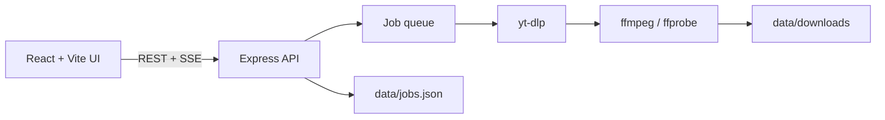

# Clipshed — Technical README

[← Back to the main README](../README.md)

This is the exhaustive reference: architecture, project layout, comparison, platform registry, command reference, and troubleshooting. For the quick overview, start with [README.md](../README.md).

**A local-first video range clipper.** Paste a link, pick MP4, MP3, or both, and fetch only the section you need — no full-hour download followed by a manual trim. Works with YouTube, Facebook, and Instagram links.

[](https://github.com/ivsharma/clipshed/actions/workflows/ci.yml)


## Why this exists

Most video downloaders treat the time range as an afterthought:

1. Download the entire video.
2. Open it in a separate editor.
3. Trim the part you actually wanted.

Clipshed treats the range as the primary input. If you want **15:00–20:00** from a one-hour talk, it downloads only that section, then merges or converts it locally.

It also exposes a workflow that generic yt-dlp GUIs usually hide: **fast vs exact cuts**, **MP4 + MP3 from one download**, live progress, cancellation, and a timeline with chapter markers.

## Screenshots


*Pick MP4, MP3, or both; drag the handles or type exact times.*


*One section download produces both MP4 and MP3, with separate download buttons.*

## Features

- **YouTube:** watch links, `youtu.be`, Shorts, embeds, and livestream replays
- **Facebook:** `watch` links, reels, page videos, and `fb.watch` links (experimental; some posts need cookies)
- **Instagram:** posts, reels, and IGTV (experimental; most content needs cookies from a signed-in browser)
- **MP4** with selectable resolution (H.264 up to 1080p by default; VP9/AV1 at higher resolutions)
- **MP3** at 128, 192, 256, or 320 kbps
- **Both** — MP4 and MP3 for the same range in one job
- **Full video** or an exact **start/end range**
- Timeline with draggable handles and chapter markers
- **Fast cut** (keyframe-aligned, no quality loss) or **Exact cut** (frame-accurate re-encode)
- Live progress over SSE: stage, percent, bytes, speed, ETA
- Cancellation that kills the whole yt-dlp/ffmpeg process tree
- Job history with re-download and cleanup
- Optional cookies for age-restricted, private, or bot-checked videos
- Update yt-dlp from the settings dialog
- Local-only; no account, no cloud, no telemetry

## How the range download works

YouTube usually serves video and audio separately. Clipshed asks yt-dlp for only the selected section:

```text
yt-dlp --download-sections "*00:15:00.000-00:20:00.000" ...
```

- **MP4:** yt-dlp downloads the selected video and audio range and muxes them together.
- **MP3:** yt-dlp downloads the audio range and converts it to MP3.
- **Both:** the app downloads the MP4 section once, then extracts the MP3 from that same source. No second range download.

**Fast cut** uses stream copy. It is fast, lossless, and snaps the start to the nearest keyframe, so it may include a few extra seconds at the beginning. **Exact cut** adds `--force-keyframes-at-cuts`, which re-encodes at the cut points for frame accuracy; it is slower, especially at 4K.

MP3 is always re-encoded, so its cuts are effectively sample-accurate.

## Comparison

Stars are approximate as of November 2026 and change daily. This table is about **workflow**, not a scoreboard.

| Project | Stars | Form | Range-first? | Notes |
|---|---:|---|---|---|
| [Cobalt](https://github.com/imputnet/cobalt) | ~46k | Web/API, hosted or self-hosted | No | Beautiful multi-service downloader; full-item flow |
| [Seal](https://github.com/JunkFood02/Seal) | ~30k | Android app | No | Polished yt-dlp frontend for mobile |
| [MeTube](https://github.com/alexta69/metube) | ~15k | Self-hosted web UI (Docker) | Chapter split only | Great queue/playlists; not arbitrary start/end |
| [Open Video Downloader](https://github.com/jely2002/youtube-dl-gui) | ~10k | Desktop GUI (Tauri) | No | Cross-platform yt-dlp GUI |
| [yt-dlp-web-ui](https://github.com/marcopiovanello/yt-dlp-web-ui) | ~2.6k | Self-hosted web UI | No | Archived yt-dlp RPC/web UI |
| [yt-short-clipper](https://github.com/jipraks/yt-short-clipper) | ~1.1k | Desktop app | Automatic highlights | AI reframing/captions for Shorts; not manual ranges |
| [lord-of-the-clips](https://github.com/ranelpadon/lord-of-the-clips) | ~68 | CLI | Yes | Download, trim, merge; terminal-only |
| [RangeDownloader](https://github.com/A-Soul-Database/RangeDownloader) | ~21 | Python | Yes | Small, older range downloader |
| [Downcut](https://github.com/sagarjethi/self-hosted-video-downloader) | ~1 | Self-hosted web UI | Yes | Timeline cutter; Docker-oriented |
| **Clipshed** | — | **Local web app** | **Yes** | **Timeline + MP4/MP3/Both + local-first** |

If you need playlists, channels, subtitles, or a Docker service, MeTube and Cobalt are stronger choices. Clipshed is intentionally narrower: one video, one range, clean local output.

## Quick start

Requirements: Windows 10/11 and Node.js **22+**.

```powershell
npm install
npm run setup
npm run dev
```

Open **http://127.0.0.1:5173**.

`npm run setup` downloads the standalone `yt-dlp.exe` and static `ffmpeg`/`ffprobe` builds into `bin/`. No Python install is required.

### Production-style run

```powershell
npm run build
npm start
```

Open **http://127.0.0.1:3000**. Express serves the built React app and the API from the same origin.

Or:

```powershell
powershell -ExecutionPolicy Bypass -File start.ps1
```

## Architecture



- The frontend never talks to a site directly; it only talks to the local API.
- `shared/src/platforms.ts` is the single place that knows about sites. Each platform turns a pasted link into a canonical URL and a media ID.
- The server only accepts links from registered platforms, and yt-dlp only ever receives the canonical URL.
- Jobs run in a small queue, with one concurrent download by default.
- yt-dlp and ffmpeg are spawned as child processes; no shell interpolation.
- Cancellation uses `taskkill /T /F` on Windows so ffmpeg children die too.
- Progress is parsed from yt-dlp and ffmpeg output and streamed over SSE.

### Tech stack

| Layer | Choice |
|---|---|
| UI | React 19, Vite 8, TypeScript, Tailwind CSS 4 |
| API | Node 24, Express 5, Zod |
| Download engine | yt-dlp (standalone) |
| Media | ffmpeg + ffprobe |
| Progress | Server-Sent Events |
| Storage | Local JSON history + `data/` folders |
| Tests | Vitest |

## Settings

Click the gear icon in the top-right.

- **No cookies** — works for most public videos.
- **Cookies file** — point to a Netscape-format `cookies.txt` exported from a browser extension.
- **From browser** — ask yt-dlp to read cookies directly from Chrome, Edge, Firefox, Brave, Chromium, Opera, or Vivaldi.
- **Prefer H.264** — keep MP4 compatibility high. Most sites offer H.264 up to 1080p.
- **Update yt-dlp** — sites change often; an outdated yt-dlp is the most common cause of failures.

Cookies stay on this machine and are never returned by the API or written to the job history.

## Project layout

```text
clipshed/
  shared/src/
    platforms.ts          Supported sites: URL parsing and canonical links
    types.ts              API and job types shared by server and UI
    schemas.ts            Request validation (Zod)
    time.ts, format.ts    Time parsing and display helpers
  server/src/
    routes.ts             All HTTP endpoints
    app.ts, index.ts      Express setup and startup
    errors.ts             AppError and the yt-dlp error rules table
    media/
      args.ts             yt-dlp command-line arguments
      probe.ts            Metadata lookup, normalisation, and cache
      formats.ts          Quality selection and format selectors
      progress.ts         yt-dlp/ffmpeg output to progress events
      download.ts         Runs a download, finalises files, handles cancel
    services/
      job-manager.ts      Queue, job lifecycle, and history persistence
      settings.ts         Settings and cookie configuration
      binaries.ts         yt-dlp/ffmpeg checks and updates
  web/src/
    App.tsx               Page state and wiring
    components/           Landing, format picker, range selector, job panel, etc.
    lib/selection.ts      Selection rules, size estimates, and validation
  scripts/
    setup-binaries.ps1    Downloads yt-dlp and ffmpeg
  docs/                   Screenshots and this technical reference
  .github/workflows/      CI
  bin/                    Local binaries (gitignored)
  data/                   Jobs, downloads, temp files (gitignored)
  start.ps1               One-command local start
```

## Adding a platform

Most new sites need two small changes:

1. **Link parsing** — add an entry to `PLATFORMS` in `shared/src/platforms.ts` with its hostnames and a `parse` function that returns a `mediaId` and canonical `url`. Add tests next to the existing ones in `platforms.test.ts`.
2. **Error hints (optional)** — if the site fails with a specific message, add a rule to `RULES` in `server/src/errors.ts`. Rules are checked in order, so put site-specific rules before the generic ones.

yt-dlp already supports hundreds of sites, so the download path itself usually needs no changes. Check that the site works with `yt-dlp` on the command line first.

## Commands

| Command | What it does |
|---|---|
| `npm run setup` | Download yt-dlp, ffmpeg, ffprobe |
| `npm run dev` | Vite on :5173 + API on :3000 |
| `npm run build` | Type-check and build the frontend |
| `npm start` | Serve the built app + API on :3000 |
| `npm test` | Unit tests for time parsing, URL validation, filenames, errors |
| `npm run typecheck` | Type-check server and web |

CI runs typecheck, tests, and the frontend build on every push and pull request.

## Troubleshooting

**“Sign in to confirm you’re not a bot”**  
Open Settings and add cookies from a signed-in browser (or a `cookies.txt` file). You can also try updating yt-dlp.

**“Requested format is not available”**  
The selected quality disappeared or is region/account-specific. Pick another quality or update yt-dlp.

**ffmpeg is missing**  
Run `npm run setup` again. The app expects `bin/ffmpeg.exe` and `bin/ffprobe.exe`.

**Cookies from Chrome fail**  
Close Chrome completely, then retry. Chrome can lock its cookie database while running. Firefox often works without closing. A `cookies.txt` file is the most reliable option.

**Port 3000 or 5173 is already in use**  
Stop the other process, or set `PORT` in `.env` for the server. The Vite port is configured in `web/vite.config.ts`.

**Downloads are slow**  
Section downloads use ffmpeg's range processing, which can run around 2–3× realtime. A 5-minute clip may take a couple of minutes depending on your connection and whether it is 1080p/4K. Exact cut is slower because it re-encodes.

## Limitations

- Single videos only; playlists and channels are rejected.
- Facebook and Instagram support depends on yt-dlp's extractors. Many posts need cookies from a signed-in browser, and some posts without a video height can only be downloaded as MP3. Treat these two platforms as experimental until you've tested your own links.
- Active live streams aren't supported; livestream replays are.
- No subtitles, thumbnail embedding, or SponsorBlock yet.
- No authentication or multi-user support. The server binds to `127.0.0.1`.
- Files are cleaned up after `JOB_TTL_HOURS` (default 24 hours).
- Job history is a local JSON file, capped at 100 entries.
- Re-encoding is intentionally not exposed as a “compress” mode yet. Choosing a lower source resolution is the better size/quality tradeoff.

## Roadmap

- Playlist and channel support
- Subtitle selection
- SponsorBlock segment skipping
- Optional compression presets (with honest “visually similar” labels)
- Desktop packaging via Tauri or Electron
- Multiple ranges in one job

## Contributing

Issues and pull requests are welcome. Before opening a PR:

```powershell
npm run typecheck
npm test
npm run build
```

Keep changes scoped, add a test for parsing/validation logic, and don’t commit `bin/`, `data/`, `.env`, or cookies.

## License

MIT — see [LICENSE](../LICENSE).

Clipshed is not affiliated with YouTube, Instagram, Facebook, or any other platform. yt-dlp, ffmpeg, and their builds have their own licenses; this repo downloads them at setup time instead of bundling them.

## Acknowledgements

- [yt-dlp](https://github.com/yt-dlp/yt-dlp) — the download engine
- [FFmpeg](https://ffmpeg.org/) — muxing, cutting, conversion
- [yt-dlp FFmpeg builds](https://github.com/yt-dlp/FFmpeg-Builds) — Windows binaries
- React, Vite, Tailwind CSS, Express, Zod, Vitest

## Disclaimer

This is a local, personal-use tool. Download only content you own or have permission to download. Downloading YouTube videos may violate YouTube’s Terms of Service and copyright law. Do not expose this app as a public service, and do not use it to bypass DRM, paywalls, or access controls.
