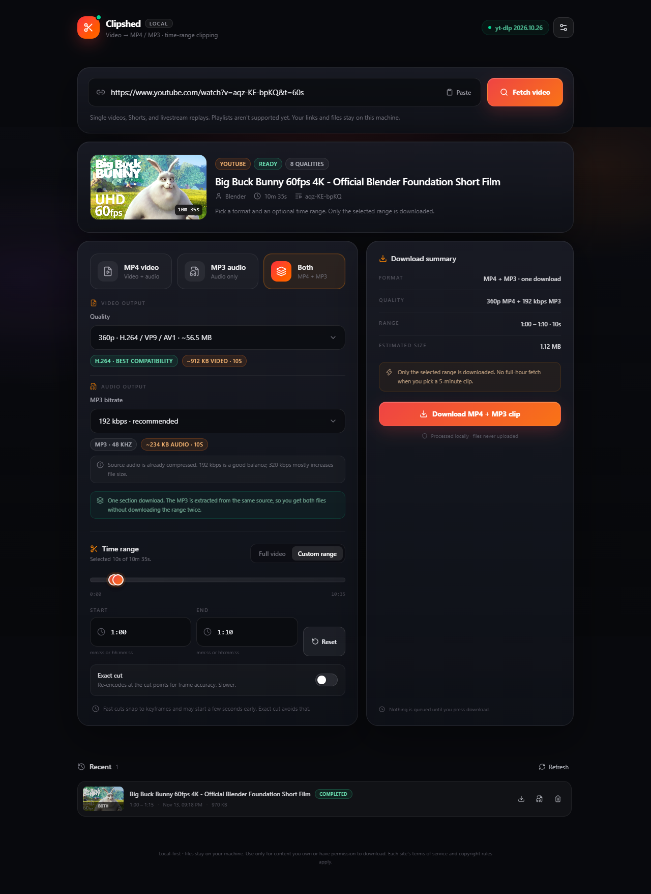
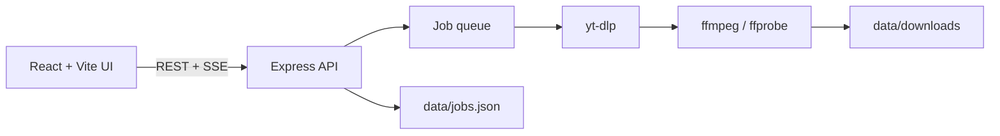

# Clipshed — Technical README

[← Back to the main README](../README.md)

This is the exhaustive reference: architecture, project layout, comparison, platform registry, command reference, and troubleshooting. For the quick overview, start with [README.md](../README.md).

**A local-first video range clipper.** Paste a link, pick MP4, MP3, or both, and fetch only the section you need — no full-hour download followed by a manual trim. Works with YouTube, Facebook, and Instagram links.

[](https://github.com/ivsharma/clipshed/actions/workflows/ci.yml)


## Why this exists

Most video downloaders treat the time range as an afterthought:

1. Download the entire video.
2. Open it in a separate editor.
3. Trim the part you actually wanted.

Clipshed treats the range as the primary input. If you want **15:00–20:00** from a one-hour talk, it downloads only that section, then merges or converts it locally.

It also exposes a workflow that generic yt-dlp GUIs usually hide: **fast vs exact cuts**, **MP4 + MP3 from one download**, live progress, cancellation, and a timeline with chapter markers.

## Screenshots



*Pick MP4, MP3, or both; drag the handles or type exact times.*


*One section download produces both MP4 and MP3, with separate download buttons.*

## Features

- **YouTube:** watch links, `youtu.be`, Shorts, embeds, and livestream replays
- **Facebook:** `watch` links, reels, page videos, and `fb.watch` links (experimental; some posts need cookies)
- **Instagram:** posts, reels, and IGTV (experimental; most content needs cookies from a signed-in browser)
- **MP4** with selectable resolution (H.264 up to 1080p by default; VP9/AV1 at higher resolutions)
- **MP3** at 128, 192, 256, or 320 kbps
- **Both** — MP4 and MP3 for the same range in one job
- **Full video** or an exact **start/end range**
- Timeline with draggable handles and chapter markers
- **Fast cut** (keyframe-aligned, no quality loss) or **Exact cut** (frame-accurate re-encode)
- Live progress over SSE: stage, percent, bytes, speed, ETA
- Cancellation that kills the whole yt-dlp/ffmpeg process tree
- Job history with re-download and cleanup
- Optional cookies for age-restricted, private, or bot-checked videos
- Update yt-dlp from the settings dialog
- **Windows desktop app** — Electron build with yt-dlp, ffmpeg/ffprobe, and QuickJS bundled; no Node install needed at runtime
- Local-only; no account, no cloud, no telemetry

## How the range download works

YouTube usually serves video and audio separately. Clipshed asks yt-dlp for only the selected section:

```text
yt-dlp --download-sections "*00:15:00.000-00:20:00.000" ...
```

- **MP4:** yt-dlp downloads the selected video and audio range and muxes them together.
- **MP3:** yt-dlp downloads the audio range and converts it to MP3.
- **Both:** the app downloads the MP4 section once, then extracts the MP3 from that same source. No second range download.

**Fast cut** uses stream copy. It is fast, lossless, and snaps the start to the nearest keyframe, so it may include a few extra seconds at the beginning. **Exact cut** adds `--force-keyframes-at-cuts`, which re-encodes at the cut points for frame accuracy; it is slower, especially at 4K.

MP3 is always re-encoded, so its cuts are effectively sample-accurate.

## Comparison

Stars are approximate as of November 2026 and change daily. This table is about **workflow**, not a scoreboard.

| Project | Stars | Form | Range-first? | Notes |
|---|---:|---|---|---|
| [Cobalt](https://github.com/imputnet/cobalt) | ~46k | Web/API, hosted or self-hosted | No | Beautiful multi-service downloader; full-item flow |
| [Seal](https://github.com/JunkFood02/Seal) | ~30k | Android app | No | Polished yt-dlp frontend for mobile |
| [MeTube](https://github.com/alexta69/metube) | ~15k | Self-hosted web UI (Docker) | Chapter split only | Great queue/playlists; not arbitrary start/end |
| [Open Video Downloader](https://github.com/jely2002/youtube-dl-gui) | ~10k | Desktop GUI (Tauri) | No | Cross-platform yt-dlp GUI |
| [yt-dlp-web-ui](https://github.com/marcopiovanello/yt-dlp-web-ui) | ~2.6k | Self-hosted web UI | No | Archived yt-dlp RPC/web UI |
| [yt-short-clipper](https://github.com/jipraks/yt-short-clipper) | ~1.1k | Desktop app | Automatic highlights | AI reframing/captions for Shorts; not manual ranges |
| [lord-of-the-clips](https://github.com/ranelpadon/lord-of-the-clips) | ~68 | CLI | Yes | Download, trim, merge; terminal-only |
| [RangeDownloader](https://github.com/A-Soul-Database/RangeDownloader) | ~21 | Python | Yes | Small, older range downloader |
| [Downcut](https://github.com/sagarjethi/self-hosted-video-downloader) | ~1 | Self-hosted web UI | Yes | Timeline cutter; Docker-oriented |
| **Clipshed** | — | **Local web app + Windows desktop** | **Yes** | **Timeline + MP4/MP3/Both + local-first** |

If you need playlists, channels, subtitles, or a Docker service, MeTube and Cobalt are stronger choices. Clipshed is intentionally narrower: one video, one range, clean local output.

## Quick start

Requirements: Windows 10/11 and Node.js **22+** to run from source. The packaged desktop app does not need Node.js.

```powershell
npm install
npm run setup
npm run dev
```

Open **http://127.0.0.1:5173**.

`npm run setup` downloads the standalone `yt-dlp.exe`, static `ffmpeg`/`ffprobe` builds, and QuickJS into `bin/`. No Python install is required.

### Production-style run

```powershell
npm run build
npm start
```

Open **http://127.0.0.1:3000**. Express serves the built React app and the API from the same origin.

Or:

```powershell
powershell -ExecutionPolicy Bypass -File start.ps1
```

### Windows desktop build

The Electron shell reuses the same server and UI. It starts the API on a random
loopback port, then loads that URL in a native window. No Node installation is
needed on the machine that runs the packaged app.

```powershell
npm run setup
npm run desktop:run    # run from source
npm run desktop:pack   # unpacked build: release/win-unpacked
npm run desktop:dist   # NSIS installer + portable exe in release/
```

Packaged data lives in `%LOCALAPPDATA%\Clipshed`; development runs use
`%LOCALAPPDATA%\Clipshed Dev`. On first launch, a managed copy of `yt-dlp.exe` is
placed in the writable app home so the in-app yt-dlp update can replace it.
ffmpeg, ffprobe, and QuickJS run from the bundled resources. The portable build
also uses this location, so it is no-install rather than fully portable.

`desktop:dist` builds `Clipshed-Setup-<version>.exe` and
`Clipshed-<version>-portable.exe`. Builds are unsigned unless a Windows
code-signing certificate is configured in `electron-builder.yml`.

The desktop bundle includes yt-dlp, ffmpeg/ffprobe, QuickJS, and the third-party
notices. QuickJS is used because packaged users do not necessarily have Node on
`PATH`; yt-dlp needs a JavaScript runtime for some YouTube challenges. See
[THIRD_PARTY_NOTICES.md](../desktop/resources/THIRD_PARTY_NOTICES.md).

The full runtime model, file layout, packaging configuration, and package-size
tradeoffs are documented in [Desktop app (Electron)](#desktop-app-electron).

## Architecture



- The frontend never talks to a site directly; it only talks to the local API.
- The desktop build uses Electron only as a shell. `desktop/main.cjs` copies bundled binaries into the app home, starts the compiled server on port 0, and loads the assigned loopback URL.
- The CLI and desktop shell share `server/src/server.ts`; `server/src/index.ts` is just the signal-handling entrypoint.
- `shared/src/platforms.ts` is the single place that knows about sites. Each platform turns a pasted link into a canonical URL and a media ID.
- The server only accepts links from registered platforms, and yt-dlp only ever receives the canonical URL.
- Jobs run in a small queue, with one concurrent download by default.
- yt-dlp and ffmpeg are spawned as child processes; no shell interpolation.
- Cancellation uses `taskkill /T /F` on Windows so ffmpeg children die too.
- Progress is parsed from yt-dlp and ffmpeg output and streamed over SSE.

### Tech stack

| Layer | Choice |
|---|---|
| UI | React 19, Vite 8, TypeScript, Tailwind CSS 4 |
| API | Node 24, Express 5, Zod |
| Download engine | yt-dlp (standalone) |
| Media | ffmpeg + ffprobe |
| Desktop | Electron 45 + electron-builder |
| Server bundle | esbuild |
| yt-dlp JS runtime | QuickJS-ng (bundled), Node in development |
| Progress | Server-Sent Events |
| Storage | Local JSON history + `data/` folders |
| Tests | Vitest |

## Desktop app (Electron)

The Windows desktop app is the same Clipshed server and UI wrapped in Electron.
It exists so people can install Clipshed and run it without Node.js, a terminal,
or `npm run dev`.

### Startup sequence

1. Electron starts `desktop/main.cjs`.
2. The main process acquires a single-instance lock. A second launch focuses the
   existing window and exits.
3. It creates the app-home and Electron user-data directories.
4. It stages a missing `yt-dlp.exe` in `%LOCALAPPDATA%\Clipshed\bin` and removes
   obsolete ffmpeg/ffprobe/QuickJS copies staged by older builds. ffmpeg,
   ffprobe, and QuickJS stay in the bundled `resources\bin`.
5. It sets the desktop environment variables, loads the compiled server bundle,
   and calls `startLocalServer({ host: "127.0.0.1", port: 0 })`.
6. The server starts the job manager, serves the API and built UI, and returns the
   OS-assigned port.
7. Electron opens a sandboxed window at `http://127.0.0.1:<port>`.

The CLI and desktop shell share `server/src/server.ts`. `server/src/index.ts` is
only the CLI entrypoint with signal handling and process-level logging.

If startup fails, Electron shows an error dialog with the failure instead of
leaving a blank window.

### Runtime model

- **Main process:** `desktop/main.cjs` owns the window, data paths, binary
  staging, local server, download handling, notifications, and shutdown.
- **Renderer:** the normal React app. It has `contextIsolation: true`,
  `nodeIntegration: false`, and `sandbox: true`. There is no preload bridge; the
  renderer talks to the local API over HTTP, just like the browser build.
- **Server:** the compiled `server.cjs` bundle runs inside the Electron main
  process. It is not a separate process. Active jobs are still child processes
  (yt-dlp and ffmpeg), so cancellation and cleanup use the same process-tree
  logic as the CLI.
- **Port:** the desktop always asks the OS for a free loopback port. It does not
  use `:3000`, so it cannot collide with the development server.
- **Instance:** only one desktop instance is allowed. Starting the EXE again
  restores and focuses the existing window.
- **Shutdown:** `before-quit` cancels active jobs, closes the server, and waits up
  to five seconds before forcing exit.

### Data and binary locations

| Path | Purpose |
|---|---|
| `%LOCALAPPDATA%\Clipshed\bin` | Managed, writable copy of yt-dlp |
| `resources\bin` | Bundled ffmpeg, ffprobe, QuickJS, and the original yt-dlp |
| `%LOCALAPPDATA%\Clipshed\data\jobs.json` | Job history |
| `%LOCALAPPDATA%\Clipshed\data\downloads` | Completed files served to the browser |
| `%LOCALAPPDATA%\Clipshed\data\tmp` | In-progress download files |
| `%LOCALAPPDATA%\Clipshed\electron` | Electron cache and user data |
| `%LOCALAPPDATA%\Clipshed Dev` | The same layout for an unpackaged `desktop:run` |

Only yt-dlp is copied out of the installation because it is the only bundled tool
that updates itself. `yt-dlp -U` needs a writable location, and the app runs as a
normal user without elevation. ffmpeg, ffprobe, and QuickJS execute directly from
`resources\bin`.

The managed yt-dlp copy is deliberately “missing only”: an existing copy is never
overwritten. That is what lets an in-app yt-dlp update survive app restarts and
reinstalls. It also means a newer Clipshed build will not replace an older
managed yt-dlp automatically. Delete `%LOCALAPPDATA%\Clipshed\bin` to let the
next launch stage the bundled version again.

On upgrade from a build that staged all four binaries, the obsolete
ffmpeg/ffprobe/QuickJS copies in the app home are removed at startup. This keeps
the first launch of 1.0.0 from carrying a second copy of the media binaries.

The uninstaller removes the installed program but leaves `%LOCALAPPDATA%\Clipshed`
intact. Delete that folder manually for a clean reset.

### Desktop environment

The main process sets these variables before loading the server bundle:

| Variable | Packaged value |
|---|---|
| `CLIPSHED_ROOT` | `%LOCALAPPDATA%\Clipshed` |
| `DATA_DIR` | `%LOCALAPPDATA%\Clipshed\data` |
| `BIN_DIR` | `%LOCALAPPDATA%\Clipshed\bin` (managed yt-dlp) |
| `FFMPEG_DIR` | `resources\bin` |
| `QJS_PATH` | `resources\bin\qjs.exe` |
| `WEB_DIST` | `resources\web\dist` |
| `CLIPSHED_VERSION` | `app.getVersion()`, e.g. `1.0.0` |
| `NODE_ENV` | `production` |

`HOST` and `PORT` are not used by the desktop shell; it passes host and port
arguments directly to `startLocalServer()`. In source runs, `WEB_DIST` points at
`web\dist`, the server bundle is `desktop\build\server.cjs`, and the app home is
`%LOCALAPPDATA%\Clipshed Dev`.

### Server bundle

`npm run desktop:server` runs `scripts/build-desktop.mjs`, which bundles
`server/src/server.ts` into `desktop/build/server.cjs` with esbuild.

The bundle is CommonJS on purpose. Express and body-parser contain dynamic
`require` calls that do not work in an ESM output. The build also replaces
`import.meta.url` with a banner-backed `__CLIPSHED_MODULE_URL` constant so the
shared config code can still resolve paths if no environment overrides are set.

### Window, links, and security

- External `http(s)` links open in the default browser.
- In-window navigation away from the loopback origin is blocked.
- The renderer cannot access Node or the filesystem directly.
- F12 opens DevTools only in an unpackaged source run.
- The local API has no authentication, matching the browser build. It binds to
  `127.0.0.1` only; do not run Clipshed on a shared or untrusted machine.
- The app has no accounts, telemetry, or upload path.

### Downloads

Electron handles the app's file links through `session.defaultSession`:

- The save location is the Windows **Downloads** folder.
- If the filename exists, Clipshed adds ` (1)`, ` (2)`, and so on.
- On completion, a Windows notification says the file is ready. Clicking it opens
  Explorer at the saved file.
- The server's copy under `data\downloads` is temporary and is cleaned up by the
  normal job-retention cleanup.

### QuickJS and yt-dlp

yt-dlp sometimes needs a JavaScript runtime to solve YouTube challenges.
Packaged users do not necessarily have Node on `PATH`, so Clipshed bundles
QuickJS-ng and passes it explicitly:

```text
--js-runtimes quickjs:<Clipshed install>\resources\bin\qjs.exe
```

If `qjs.exe` is absent, the shared argument builder falls back to `node`. This
keeps normal development working without QuickJS while making the packaged app
self-contained. QuickJS is MIT-licensed; see
[THIRD_PARTY_NOTICES.md](../desktop/resources/THIRD_PARTY_NOTICES.md).

### Updating components

- **yt-dlp:** Settings → **Update yt-dlp** runs `yt-dlp -U` against the managed
  copy in `%LOCALAPPDATA%\Clipshed\bin`. It works in both the installer and
  portable builds without an admin prompt.
- **ffmpeg / ffprobe / QuickJS:** these run from the bundled resources; install a
  new Clipshed build to change them.
- **Clipshed itself:** there is no app auto-updater yet. `electron-builder`
  generates `latest.yml` and `app-update.yml`, but no client code uses them.
- Avoid updating yt-dlp while a download is running. Windows can lock an
  executable that is currently in use.

### Packaging

The desktop packaging configuration lives in `electron-builder.yml`:

| Setting | Value |
|---|---|
| App ID | `com.clipshed.app` |
| Targets | Windows x64 NSIS installer and portable EXE |
| Installer | Per-user, changeable install directory, desktop and Start Menu shortcuts |
| Compression | `normal` |
| ASAR | Enabled |
| Output | `release/` (gitignored) |
| Signing | None configured; SmartScreen may warn |

Packaged resource map:

| Source | Packaged location |
|---|---|
| `desktop/main.cjs`, `package.json` | `resources\app.asar` |
| `desktop/build/server.cjs` | `resources\server\server.cjs` |
| `web/dist` | `resources\web\dist` |
| `bin/yt-dlp.exe`, `ffmpeg.exe`, `ffprobe.exe`, `qjs.exe` | `resources\bin` |
| `desktop/resources/icon.ico` | `resources\icon.ico` |
| `LICENSE`, third-party notices | `resources\` |

`desktop:verify` checks that all four binaries exist before packaging.
`desktop:check` syntax-checks the Electron main file and build scripts and runs
in CI. Packaging itself is local because CI does not carry the ignored binaries
or download the Electron binary.

The NSIS installer defaults to a per-user location, usually
`%LOCALAPPDATA%\Programs\Clipshed`. The portable target is a self-extracting
launcher: it installs nothing, but it still uses `%LOCALAPPDATA%\Clipshed` for
data and the managed yt-dlp copy. It is “no-install”, not fully portable.

### Package size

The installation directory is about **708 MB**:

| Part | Approx. size |
|---|---:|
| Electron/Chromium runtime and support files | 357 MB |
| `ffmpeg.exe` | 162 MB |
| `ffprobe.exe` | 162 MB |
| `yt-dlp.exe` | 23 MB |
| QuickJS | 2 MB |
| App, server bundle, UI, notices | 2.4 MB |

The compressed artifacts are about **235 MB** for the installer and **217 MB**
for the portable EXE. After first launch, `%LOCALAPPDATA%\Clipshed` adds only
the managed yt-dlp copy (~23 MB) plus history and downloads, not a second copy of
ffmpeg, ffprobe, or QuickJS.

Possible reductions, roughly in order of effort versus payoff:

| Option | Approx. installed saving | Approx. artifact saving | Tradeoff |
|---|---:|---:|---|
| Remove `ffprobe`; derive duration from ffmpeg or job metadata | ~162 MB | ~35–50 MB | Rewrite the post-download metadata step |
| Use a shared ffmpeg build (one set of DLLs) | ~100–160 MB | ~30–50 MB | More files; adjust setup paths and packaging |
| Set `compression: maximum` in `electron-builder.yml` | 0 | ~20–30 MB | Slower builds |
| Drop unused Electron locales and SwiftShader/Vulkan files | ~15–30 MB | ~5–10 MB | Must test GPU fallback |
| Download binaries on first run instead of bundling | ~300 MB initial install | ~170 MB+ | Requires network, hosting, checksums; not self-contained |
| Tauri/WebView2 shell plus a Node sidecar | ~200 MB+ | Large | Rewrites the shell; still needs a Node runtime |
| Custom minimal ffmpeg build | ~250 MB+ | Large | Build and maintenance burden |

The best effort-to-payoff order is: remove `ffprobe`, switch to a shared ffmpeg
build, then enable maximum compression. Those changes should bring the installed
payload into roughly the **380–450 MB** range while keeping the app fully
offline. `ffprobe` is the single biggest easy win because the code only uses it
for the finished file's duration and size. Size and checksum claims will need to
be re-measured after any of these changes.

## Settings

Click the gear icon in the top-right.

- **No cookies** — works for most public videos.
- **Cookies file** — point to a Netscape-format `cookies.txt` exported from a browser extension.
- **From browser** — ask yt-dlp to read cookies directly from Chrome, Edge, Firefox, Brave, Chromium, Opera, or Vivaldi.
- **Prefer H.264** — keep MP4 compatibility high. Most sites offer H.264 up to 1080p.
- **Update yt-dlp** — sites change often; an outdated yt-dlp is the most common cause of failures.

Cookies stay on this machine and are never returned by the API or written to the job history.

The local setup panel also shows the running Clipshed version, yt-dlp, ffmpeg, and Node versions.

## Project layout

```text
clipshed/
  shared/src/
    platforms.ts          Supported sites: URL parsing and canonical links
    types.ts              API and job types shared by server and UI
    schemas.ts            Request validation (Zod)
    time.ts, format.ts    Time parsing and display helpers
  server/src/
    routes.ts             All HTTP endpoints
    app.ts                Express setup and UI serving
    server.ts             Reusable local server for CLI and desktop
    index.ts              CLI entrypoint and signal handling
    errors.ts             AppError and the yt-dlp error rules table
    media/
      args.ts             yt-dlp command-line arguments
      probe.ts            Metadata lookup, normalisation, and cache
      formats.ts          Quality selection and format selectors
      progress.ts         yt-dlp/ffmpeg output to progress events
      download.ts         Runs a download, finalises files, handles cancel
    services/
      job-manager.ts      Queue, job lifecycle, and history persistence
      settings.ts         Settings and cookie configuration
      binaries.ts         yt-dlp/ffmpeg checks and updates
  web/src/
    App.tsx               Page state and wiring
    components/           Landing, format picker, range selector, job panel, etc.
    lib/selection.ts      Selection rules, size estimates, and validation
  desktop/
    main.cjs              Electron lifecycle, paths, server, downloads
    build/server.cjs      Generated server bundle (gitignored)
    resources/            Icon, icon source, third-party notices
  scripts/
    setup-binaries.ps1    Downloads yt-dlp, ffmpeg, ffprobe, QuickJS
    build-desktop.mjs     Bundles the server for Electron with esbuild
    check-desktop.mjs     Verifies binaries before packaging
    check-version.mjs     Verifies package and lockfile version consistency
    release.mjs           Bumps versions, promotes changelog, commits, tags
  docs/                   Screenshots and this technical reference
  CHANGELOG.md            Release notes and version history
  .github/workflows/      CI
  bin/                    Local binaries (gitignored)
  data/                   Jobs, downloads, temp files (gitignored)
  release/                Packaged desktop builds (gitignored)
  electron-builder.yml    Installer/portable targets and bundled resources
  start.ps1               One-command local start
```

## Adding a platform

Most new sites need two small changes:

1. **Link parsing** — add an entry to `PLATFORMS` in `shared/src/platforms.ts` with its hostnames and a `parse` function that returns a `mediaId` and canonical `url`. Add tests next to the existing ones in `platforms.test.ts`.
2. **Error hints (optional)** — if the site fails with a specific message, add a rule to `RULES` in `server/src/errors.ts`. Rules are checked in order, so put site-specific rules before the generic ones.

yt-dlp already supports hundreds of sites, so the download path itself usually needs no changes. Check that the site works with `yt-dlp` on the command line first.

## Commands

| Command | What it does |
|---|---|
| `npm run setup` | Download yt-dlp, ffmpeg, ffprobe, QuickJS |
| `npm run dev` | Vite on :5173 + API on :3000 |
| `npm run build` | Type-check and build the frontend |
| `npm start` | Serve the built app + API on :3000 |
| `npm test` | Unit tests for time parsing, URL validation, filenames, errors |
| `npm run typecheck` | Type-check server and web |
| `npm run version:check` | Verify package and lockfile versions match |
| `npm run desktop:run` | Build and launch the Electron shell from source |
| `npm run desktop:server` | Bundle the server for Electron only |
| `npm run desktop:pack` | Build an unpacked desktop app in `release/` |
| `npm run desktop:dist` | Build the installer and portable app |
| `npm run desktop:verify` | Check that all bundled binaries exist |
| `npm run desktop:check` | Syntax-check the desktop shell and build scripts |
| `npm run release:patch` | Release a bugfix version, e.g. `1.0.1` |
| `npm run release:minor` | Release a feature version, e.g. `1.1.0` |
| `npm run release:major` | Release a breaking version, e.g. `2.0.0` |

CI runs version checks, typecheck, desktop shell checks, tests, the frontend
build, and the desktop server bundle on every push and pull request. Desktop
packaging is local because the installer includes the binaries in `bin/`.

## Versioning and releases

Clipshed uses [Semantic Versioning](https://semver.org/) with three-part
versions and `v`-prefixed Git tags.

| Version | When to use it | Example |
|---|---|---|
| `1.0.0` | First release | Initial Windows desktop release |
| `1.1.0` | New user-facing features | Playlists, a new output option |
| `1.0.1` | Bug fixes and small corrections | Fix a layout or download bug |
| `2.0.0` | Breaking changes | Incompatible job-history or API changes |

### Version source of truth

`package.json` at the repository root is the canonical version. The workspace
package versions and `package-lock.json` must match it. `npm run version:check`
fails if they drift, and CI runs it on every push.

Do **not** bump the version for every commit. Version numbers describe shipped
builds. Commit SHAs identify individual pushes; Git tags identify releases.

`desktop:dist` reads the root version automatically, so artifact names follow
the release without editing `electron-builder.yml`:

```text
Clipshed-Setup-1.1.0.exe
Clipshed-1.1.0-portable.exe
```

Keep `appId: com.clipshed.app` unchanged. That is what lets a newer installer
upgrade the existing installation in place. The app version is also shown in
Settings → **03 / Local setup** and returned by `/api/health`.

### Release flow

1. Add user-facing notes under `## [Unreleased]` in `CHANGELOG.md`.
2. Commit or merge all changes. The release script requires a clean working tree
   on `main`.
3. Run the appropriate release command:

   ```powershell
   npm run release:minor
   ```

   The script checks versions, typechecks, runs tests and desktop checks, builds
   the frontend and server bundle, bumps the root and workspace versions,
   updates `package-lock.json`, promotes the changelog notes, commits
   `chore(release): v1.1.0`, and creates the annotated tag `v1.1.0`. It does not
   push.
4. Push the commit and tag:

   ```powershell
   git push origin main --follow-tags
   ```

5. Build the artifacts:

   ```powershell
   npm run desktop:dist
   ```

6. Create a GitHub Release for the tag and attach the installer, portable EXE,
   and their SHA-256 hashes. `release/` is gitignored; the release page is the
   distribution point, not the repository.

Use `npm run release:patch` for hotfixes and `npm run release:major` only for
breaking changes. `node scripts/release.mjs minor --dry-run` prints the next
version without changing anything.

The initial `1.0.0` release is the bootstrap case: set the version and changelog
entry manually, commit, then create the tag with
`git tag -a v1.0.0 -m "Clipshed 1.0.0"`. Subsequent releases use the script so
the version, changelog, commit, and tag stay in sync.

There is still no automatic app updater. A release tag and GitHub Release do not
update installed copies; users install a newer build manually. Only yt-dlp
updates itself from Settings.

## Troubleshooting

**“Sign in to confirm you’re not a bot”**  
Open Settings and add cookies from a signed-in browser (or a `cookies.txt` file). You can also try updating yt-dlp.

**“Requested format is not available”**  
The selected quality disappeared or is region/account-specific. Pick another quality or update yt-dlp.

**ffmpeg is missing**  
Run `npm run setup` again. The app expects `bin/ffmpeg.exe`, `bin/ffprobe.exe`, and
(for packaged YouTube support) `bin/qjs.exe`.

**Windows says the desktop app is unsafe**<br>
The build is currently unsigned. SmartScreen can warn on first launch of an
unsigned installer. Use “More info → Run anyway”, or sign the build with a
Windows code-signing certificate before distributing it widely.

**The desktop build says binaries are missing**<br>
Run `npm run setup` before `npm run desktop:dist`. The installer bundles the
four binaries from `bin/`.

**The desktop app shows old downloads or settings after switching builds**<br>
The installer, portable EXE, and source desktop run share
`%LOCALAPPDATA%\Clipshed` (source runs use `Clipshed Dev`). They intentionally
share history and the managed yt-dlp copy. Close the app and delete the relevant
app home to reset it.

**How do I reset the desktop app?**<br>
Close Clipshed, then delete `%LOCALAPPDATA%\Clipshed\data` and
`%LOCALAPPDATA%\Clipshed\electron`. Keep `bin` to avoid re-copying yt-dlp, or
delete `bin` too to restore the yt-dlp version bundled with the app. Uninstalling
does not remove `%LOCALAPPDATA%\Clipshed`.

**Update yt-dlp fails in the desktop app**<br>
Close active downloads first; Windows can lock a running executable. Make sure
`%LOCALAPPDATA%\Clipshed\bin` is writable, then retry from Settings. The update
runs as your normal user and does not need administrator rights.

**The desktop EXE is much larger than expected**<br>
The package includes Electron, ffmpeg, ffprobe, yt-dlp, and QuickJS. See
[Package size](#package-size) for the breakdown and reduction options.

**Cookies from Chrome fail**  
Close Chrome completely, then retry. Chrome can lock its cookie database while running. Firefox often works without closing. A `cookies.txt` file is the most reliable option.

**Opera GX**<br>
yt-dlp’s browser mode only reads **Opera Stable**, not Opera GX. Export a `cookies.txt` file from Opera GX and choose **Cookies file** in Settings instead.

**Port 3000 or 5173 is already in use**  
This only affects the browser workflows. Stop the other process, or set `PORT`
in `.env` for the server. The Vite port is configured in `web/vite.config.ts`.
The desktop app asks Windows for a random loopback port, so it is unaffected.

**Downloads are slow**  
Section downloads use ffmpeg's range processing, which can run around 2–3× realtime. A 5-minute clip may take a couple of minutes depending on your connection and whether it is 1080p/4K. Exact cut is slower because it re-encodes.

## Limitations

- Single videos only; playlists and channels are rejected.
- Facebook and Instagram support depends on yt-dlp's extractors. Many posts need cookies from a signed-in browser, and some posts without a video height can only be downloaded as MP3. Treat these two platforms as experimental until you've tested your own links.
- Active live streams aren't supported; livestream replays are.
- No subtitles, thumbnail embedding, or SponsorBlock yet.
- No authentication or multi-user support. The server binds to `127.0.0.1`.
- Desktop builds are Windows x64 only, unsigned, and have no automatic app
  updater. Only yt-dlp updates itself from Settings.
- The installer and portable build are large because Electron and
  ffmpeg/ffprobe are bundled. See [Package size](#package-size).
- Files are cleaned up after `JOB_TTL_HOURS` (default 24 hours).
- Job history is a local JSON file, capped at 100 entries.
- Re-encoding is intentionally not exposed as a “compress” mode yet. Choosing a lower source resolution is the better size/quality tradeoff.

## Roadmap

- Playlist and channel support
- Subtitle selection
- SponsorBlock segment skipping
- Optional compression presets (with honest “visually similar” labels)
- Code signing and automatic desktop app updates
- Smaller desktop package (see [Package size](#package-size))
- Multiple ranges in one job

## Contributing

Issues and pull requests are welcome. Before opening a PR:

```powershell
npm run typecheck
npm test
npm run build
```

Keep changes scoped, add a test for parsing/validation logic, and don’t commit `bin/`, `data/`, `.env`, or cookies.

## License

MIT — see [LICENSE](../LICENSE).

Clipshed is not affiliated with YouTube, Instagram, Facebook, or any other platform. yt-dlp, ffmpeg, QuickJS, Electron, and their builds have their own licenses. Development downloads the media binaries during setup; the Windows desktop package bundles them. See [THIRD_PARTY_NOTICES.md](../desktop/resources/THIRD_PARTY_NOTICES.md).

## Acknowledgements

- [yt-dlp](https://github.com/yt-dlp/yt-dlp) — the download engine
- [FFmpeg](https://ffmpeg.org/) — muxing, cutting, conversion
- [yt-dlp FFmpeg builds](https://github.com/yt-dlp/FFmpeg-Builds) — Windows binaries
- [Electron](https://www.electronjs.org/) and [electron-builder](https://www.electron.build/) — desktop shell and packaging
- [QuickJS-ng](https://github.com/quickjs-ng/quickjs) — bundled JavaScript runtime for yt-dlp
- React, Vite, Tailwind CSS, Express, Zod, Vitest, esbuild

## Disclaimer

This is a local, personal-use tool. Download only content you have the right to use, and follow each site’s terms of service and copyright law. Do not expose this app as a public service, and do not use it to bypass DRM, paywalls, or access controls.
